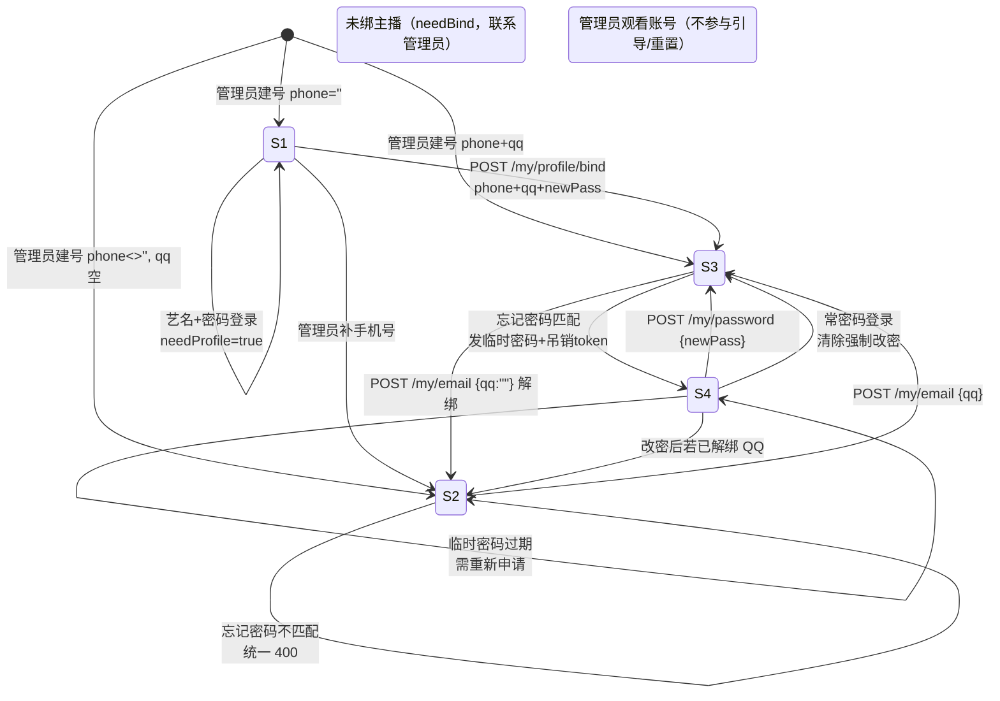
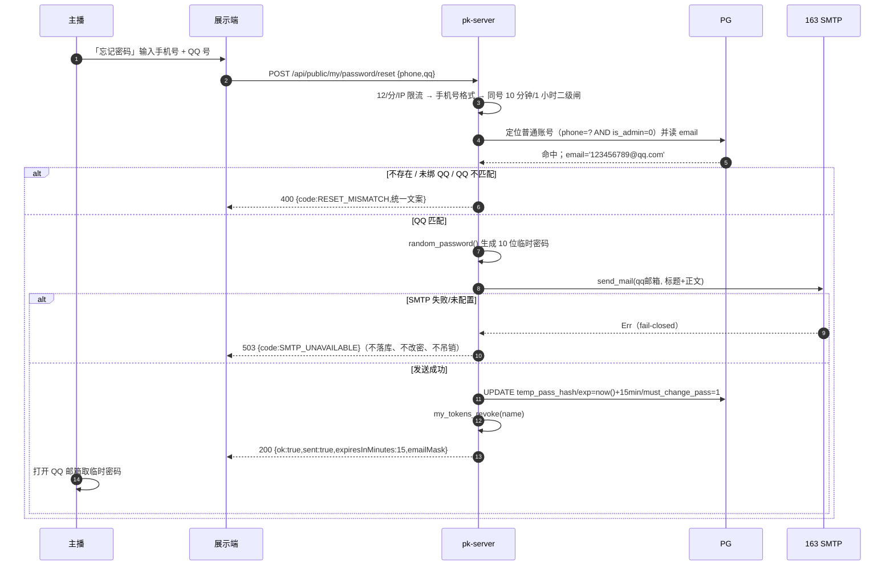
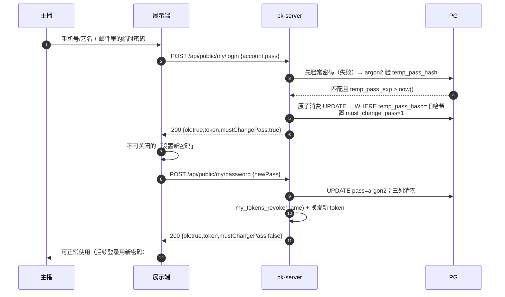

# 02 · 登录、绑定与忘记密码流程 / 接口契约

> 归属：`docs/26-账号绑定QQ邮箱与艺名登录-设计/`。
> 本文只负责**登录解析、账号状态机、首次绑定引导、QQ 绑定弹窗字段、忘记密码与临时密码**的流程与接口契约；表结构与迁移 039 的 DDL 以**文档①（`01-数据模型与迁移.md`）**为准，展示端交互与文案落点以**文档③**为准，验收与拆票以**文档④**为准。
> 本地开发口径：仅本地 PG（`127.0.0.1:3318/douyin_dev`），不推远端（`AGENTS.md` §1）；本次不改代码，只冻结契约。

## 0. 依据与代码事实核对

本轮用户口径（原文要点）：绑定邮箱 = 填 QQ 号并自动补 `@qq.com`；没绑手机号的账号支持艺名登录；未绑手机号账号登录后提示绑定 QQ + 手机号 + 设置密码；已绑手机号未绑 QQ 的登录后弹窗提示；忘记密码需输入手机号 + QQ 邮箱，发临时密码到邮箱。

设计基线（不得改动主体契约）：复用 `my_accounts.email` 存完整 QQ 邮箱地址；`name` 即台账 `person.name`（艺名）；登录解析顺序为「手机号 → 艺名」；未绑手机号账号完成引导前阻断其他功能；已绑手机号未绑 QQ 走可关闭弹窗；忘记密码以「手机号 + QQ 号」双因子知识匹配同一普通账号；新增迁移 039 的 `temp_pass_hash / temp_pass_exp / must_change_pass` 三列。

撰写前已核对的代码事实（行号以当前工作树为准）：

| 事实 | 代码位置 |
| --- | --- |
| 免团别登录口 `POST /api/public/my/login` | `rust/crates/pk-server/src/public_teams/my.rs:156` |
| 带团别登录口 `POST /api/public/teams/{team}/verify` | `rust/crates/pk-server/src/public_teams/my.rs:11` |
| 登录校验：先手机号（纯数字 5~20 位）、未命中再按 `name` | `rust/crates/pk-server/src/store/my_account.rs:1207`（手机号分支约 1226，姓名分支约 1249） |
| 登录失败原因 `LoginFail::{BadPassword,NoAccount}`，文案「密码错误」/「账号还没开通」 | `store/my_account.rs:1186-1204` |
| 未绑主播账号登录回 `{ok:true,bound:false,needBind:true}` | `public_teams/my.rs:290-300` |
| 登录失败以 HTTP 200 + `{ok:false,error}` 返回（前端读 `d.error`） | `public_teams/my.rs:275`；前端 `public_teams/st_page.html:2408-2418` |
| 登录限速已整体移除（2026-10-17），仅保留地区门禁和 `access_logs` 登录日志 | `public_teams/my.rs:197-203`；日志 `public_teams/ipinfo.rs:1249-1272` |
| 身份接口 `GET /api/public/teams/{team}/my/who`，当前回明文 `email` | `public_teams/minutes.rs:827-892`（`email` 在 855/862/868/892） |
| `who` 对未绑主播账号回**明文** `phone` | `public_teams/minutes.rs:853` |
| 已绑主播账号 `who` 的 `phone` 已服务端打码 | `public_teams/minutes.rs:886-892`；打码函数 `public_teams/wx.rs:220-236` |
| 改密接口 `POST /api/public/my/password`，只认 `X-My-Token` | `public_teams/my.rs:487` |
| 改密 store 实现（不校验旧密码） | `store/my_account.rs:1499` → `self_set_password_inner:1406` |
| 忘记密码 `POST /api/public/my/password/reset`，当前只收 `{phone}` | `public_teams/my.rs:563` |
| 重置定位普通账号（按手机号、`is_admin=0`、读 email） | `store/my_account.rs:1330-1360` |
| 重置落库 | `store/my_account.rs:1368` |
| 重置二级闸：同手机号 10 分钟 1 次 / 1 小时 3 次 | `public_teams/my.rs:415-472`（常量 418/420/422） |
| 重置 IP 限流 12 次/分；改密写口 5 次/分 | `public_teams/my.rs:392`、`public_teams/my.rs:381` |
| 绑定邮箱 `POST /api/public/my/email {email}`，只认 token | `public_teams/my.rs:648-689` |
| 邮箱格式校验（空串 = 解绑） | `store/my_account.rs:158` |
| 写邮箱（无唯一性检查） | `store/my_account.rs:1582-1605` |
| 账号信息查询（已含 email，038 未跑时回落老查询） | `store/my_account.rs:1509-1560` |
| 管理端账号列表未选 email 列 | `store/my_account.rs:271-296` |
| 管理端建号/改密 `POST /api/admin/my-accounts` | `public_teams/admin.rs:31-90`；store `my_account_set:329` / `my_account_set_pool:338` |
| token 内存 + Redis 持久化、按账号吊销 | `public_teams/admin.rs:494`（put）、`519`（take）、`605`（revoke）；TTL 24h `admin.rs:318` |
| 登录态校验统一入口 `my_ident`（推送写接口） | `public_teams/wx.rs:9-24` |
| 登录日志账号清洗、手机号/邮箱打码 | `ipinfo.rs:1557`、`wx.rs:220`、`wx.rs:239` |
| 邮件发送（163 SMTP，未配置 fail-closed） | `rust/crates/pk-server/src/mailer.rs:1-20`、`125` |
| CSPRNG 随机密码（10 位、去易混淆字符） | `rust/crates/pk-server/src/random.rs:42-47` |
| 路由注册处 | `rust/crates/pk-server/src/main.rs:473-483` |
| 迁移 038 已存在（email 列） | `rust/crates/pk-server/src/migrations/038_my_account_email.sql` |
| 自助绑定主播接口已删除 | `public_teams/my.rs:691-700` |

> 说明：`my_accounts.bound`（1 = 账号已绑定主播）与本文的「已绑手机号 / 已绑 QQ」是**三个正交维度**，不能混用。旧字段 `needBind` 继续表示「账号未绑定主播，请联系管理员」（`my.rs:299`），不表示本文的手机号/QQ 绑定。

---

## 1. 账号状态机

### 1.1 判定维度

| 维度 | 判定 | 来源 |
| --- | --- | --- |
| `bound` | `my_accounts.bound = 1` 且非管理员 | `my_account_info`（`store/my_account.rs:1509`） |
| `is_admin` | `my_accounts.is_admin = 1`（管理员观看账号） | 同上 |
| `phone_bound` | `my_accounts.phone <> ''` | 同上（手机号归一后） |
| `qq_bound` | `my_accounts.email <> ''` 且以 `@qq.com` 结尾 | `my_account_mail` 读取（`store/my_account.rs:1562`） |
| `temp_pending` | `my_accounts.must_change_pass = 1` | 039 新增列，DDL 以文档①为准 |
| `profile_ready` | `phone_bound && 账号已登记密码（`pass <> ''`）` | `store/my_account.rs:1406` 的「未登记密码」口径 |

> 依赖声明：本文按 039 三列名 `temp_pass_hash VARCHAR(255) NOT NULL DEFAULT ''`、`temp_pass_exp TIMESTAMPTZ NULL`、`must_change_pass SMALLINT NOT NULL DEFAULT 0` 描述契约；若文档①最终列名不同，以文档①为准并同步改本文引用。
> 039 未执行时的兼容：所有新增 SQL 读列失败必须**回落到老查询**（与 038 在 `my_account_info` 里的回落口径一致，`store/my_account.rs:1524-1548`），不得让未跑迁移的库整体登不进去。

### 1.2 状态定义

| 状态 | 名称 | 判定 | 登录方式 | 登录后动作 |
| --- | --- | --- | --- | --- |
| **S1** | 未绑手机号（艺名登录） | `bound=1 && !is_admin && !phone_bound` | 艺名 + 密码（手机号路径不可能命中） | 强制引导：绑手机号 + 绑 QQ + 设密码（`needProfile=true`） |
| **S2** | 已绑手机号未绑 QQ | `phone_bound && !qq_bound && !is_admin` | 手机号或艺名 + 密码 | 可关闭的绑 QQ 弹窗（`needQq=true`），入口常驻「我的」页 |
| **S3** | 已绑 QQ（完整） | `phone_bound && qq_bound && !is_admin` | 手机号或艺名 + 密码 | 正常使用；可在「我的」页改绑/解绑 QQ |
| **S4** | 临时密码待改密 | `must_change_pass=1`（底层必为 S2/S3，因为重置要求手机号+QQ 均已绑） | 临时密码（常密码仍然有效，见 §10-A） | 强制改密（`mustChangePass=true`），改密完成回 S3/S2 |
| **B1** | 未绑主播账号（旁支） | `bound=0 && !is_admin` | 手机号/占位名 + 密码 | `needBind=true`，联系管理员绑定主播；接口已删除，不自助绑定（`my.rs:691-700`） |
| **B2** | 管理员观看账号（旁支） | `is_admin=1` | 手机号/账号名 + 密码，或管理员快捷口令 | 不参与 QQ/手机号引导，也不参与忘记密码重置（`is_admin=0` 过滤，`store/my_account.rs:1343`） |

`needQq` 的判定必须**排除** S1 与管理员：`needQq = phone_bound && !qq_bound && !needProfile && !is_admin`。
`needProfile` 的判定：`needProfile = !is_admin && !phone_bound`（B1 除外：B1 另由 `needBind` 表达，且 `bound=0` 的账号 `name` 是手机号占位，不可能艺名登录）。

### 1.3 状态转移表

| # | 当前 | 事件 | 守卫 / 校验 | 新状态 | 副作用 / 响应 |
| --- | --- | --- | --- | --- | --- |
| T1 | 无账号 | 管理员开号（`POST /api/admin/my-accounts`，phone 选填） | `validate_my_account` + 手机号查重（`store/my_account.rs:338-359`） | phone 空 → S1；phone 非空且 qq 空 → S2；qq 非空 → S3 | 吊销旧 token（`admin.rs:90`） |
| T2 | S1 | 艺名 + 密码登录 | 手机号路径不命中 → 姓名命中且密码正确（`store/my_account.rs:1245-1267`） | S1 | 200 `{ok:true,token,needProfile:true}` |
| T3 | S1 | `POST /api/public/my/profile/bind {phone,qq,newPass}` | 见 §3.2 全部校验 | S3 | 换发 token；审计日志；`needProfile=false, needQq=false` |
| T4 | S1 | 管理员补手机号 | 手机号唯一 | S2 | 吊销 token（`admin.rs:90`） |
| T5 | S1 | 管理员补 QQ | QQ 唯一 + `@qq.com` 归一 | S3 | 同上 |
| T6 | S2 | 手机号/艺名 + 密码登录 | 常密码正确 | S2 | 200 `{ok:true,needQq:true}` |
| T7 | S2 | `POST /api/public/my/email {qq}` | QQ 格式 + 未被占用 | S3 | 200 `{ok:true,emailMask}`；写日志 |
| T8 | S2 | 忘记密码 `{phone,qq}` | 双因子不匹配（未绑 QQ）→ 统一 400 | S2 | 不产生任何状态变化 |
| T9 | S3 | 手机号/艺名 + 密码登录 | 常密码正确 | S3 | 200 `{ok:true,needQq:false}` |
| T10 | S3 | `POST /api/public/my/email {qq:""}`（解绑） | 已登录、非 S1 | S2 | `email=''`；`needQq` 复现 |
| T11 | S3 | `POST /api/public/my/password/reset {phone,qq}` 匹配 | 手机号存在、`is_admin=0`、`email = qq + "@qq.com"` | S4 | 临时密码邮件 + 落库 `temp_pass_*` + `must_change_pass=1` + 吊销全部 token |
| T12 | S2 | 同上 | 未绑 QQ → 统一 400 | S2 | 无变化 |
| T13 | S4 | 临时密码登录 | 常密码失败 → temp 哈希匹配且 `temp_pass_exp > now()` | S4 | 单次消费：清 `temp_pass_hash/exp`；置 `must_change_pass=1`；返回 `mustChangePass:true` |
| T14 | S4 | 临时密码已过期后再登录 | 哈希匹配但 `exp <= now()` | S4 | 200 `{ok:false,code:"TEMP_EXPIRED"}`，需重新申请 |
| T15 | S4 | 常密码登录 | 常密码正确 | S3 或 S2 | 清 `temp_pass_*` 与 `must_change_pass`（用户已持有当前密码，无需强制改密） |
| T16 | S4 | `POST /api/public/my/password {newPass}` | 格式合法；token 有效 | S3 / S2 | 改 `pass`；清三列；吊销旧 token 并换发新 token（`my.rs:534-535`） |
| T17 | S4 | 管理员改密（`POST /api/admin/my-accounts`） | 管理员口令 | S3 / S2 | 改 `pass` 并**清 `temp_pass_*` 与 `must_change_pass`**（否则账号永久处于强制改密态） |

### 1.4 状态图



---

## 2. 登录流程

### 2.1 输入与解析顺序

沿用现有口径（`store/my_account.rs:1207-1271`）：

1. 读 `body.account`，兼容旧 `body.name`；空 → **400** `{code:"INVALID_INPUT", error:"请输入账号和密码"}`（现有文案，`my.rs:222`）。
2. `normalize_phone`（去空格、`-`、`.`，`store/my_account.rs:1175`），若归一后为**纯数字且长度 5~20**，先当手机号查 `my_accounts.phone`。
3. 手机号**命中但密码错** → 不再走艺名分支，直接 `BadPassword`「密码错误」（防止同名艺名串号）。
4. 手机号未命中（含输入是数字但库里没有该手机号），按 `my_accounts.name = account` 精确查艺名。
5. 姓名命中且密码错 → `BadPassword`；姓名也不存在 → `NoAccount`「账号还没开通」。
6. 密码命中后如为存量明文口令，就地升级 argon2id（`upgrade_my_password_if_plain`，`store/my_account.rs:121`）。

**边界**：如果某主播艺名本身是纯数字（如艺名「12345」），会被手机号优先规则抢先；该账号若没绑手机号仍能在第 4 步按姓名命中；若恰好另一个账号的手机号与艺名相同，则按手机号账号登录——这属于产品已接受的歧义（见 §11-Q9）。绑定手机号后这类歧义会消失。

### 2.2 失败文案区分（保留现有枚举语义）

| 场景 | HTTP | 响应体 | 说明 |
| --- | --- | --- | --- |
| 账号或密码为空 | 400 | `{"error":"请输入账号和密码","code":"INVALID_INPUT"}` | `my.rs:222` 现有 |
| 手机号/艺名存在但密码错 | 200 | `{"ok":false,"error":"密码错误","code":"BAD_PASSWORD"}` | `LoginFail::BadPassword`（`store/my_account.rs:1198`） |
| 手机号/艺名都不存在 | 200 | `{"ok":false,"error":"账号还没开通","code":"NO_ACCOUNT"}` | `LoginFail::NoAccount`（`store/my_account.rs:1199`） |
| 地区门禁拒绝 | 403 | `{"error":"当前地区暂不支持访问"}` | `my.rs:195` |
| 临时密码过期 | 200 | `{"ok":false,"error":"临时密码已过期，请重新获取","code":"TEMP_EXPIRED"}` | 仅在 temp 哈希**验签通过**后才判过期，不向未持有密码者泄露「存在待改密账号」 |

> 现有实现有意区分「密码错误 / 账号还没开通」，枚举面（能拿艺名试探谁开了号）已被产品接受，注释见 `store/my_account.rs:1184-1186`。忘记密码入口另按防枚举策略处理（§5.6），两者不冲突。

### 2.3 登录成功响应字段（`POST /api/public/my/login` 与 `verify` 共用）

| 字段 | 类型 | 含义 | 现状 / 变更 |
| --- | --- | --- | --- |
| `ok` | bool | 成功标记 | 现有 |
| `personId` | number | 台账主播 id；0 = 管理员观看账号或未绑主播 | 现有 |
| `name` | string | 展示名（已绑主播时为艺名；未绑主播时为账号名/占位） | 现有 |
| `team` | string | `male` / `female` / `""`（任意团） | 现有 |
| `token` | string | `my-<16hex>-<16hex>`，24h（`admin.rs:318`） | 现有 |
| `bound` | bool | 账号是否已绑定主播（`my_accounts.bound`） | 现有，语义不变 |
| `needBind` | bool | 未绑主播，需联系管理员 | 现有，语义不变 |
| `needProfile` | bool | **新增**：需完成「手机号+QQ+密码」强制引导 | 新增 |
| `needQq` | bool | **新增**：已绑手机号未绑 QQ，弹可关闭提示 | 新增 |
| `mustChangePass` | bool | **新增**：临时密码登录后必须改密 | 新增（039） |
| `phone` | string | 打码手机号；未绑为空串 | **登录响应新增**（当前登录响应没有该字段；`who` 已按此口径下发） |
| `emailMask` | string | **新增**：打码 QQ 邮箱，如 `123***@qq.com`；未绑为空串 | 新增 |
| `switchable` | bool | 全团账号可切团 | 现有 |
| `admin` | bool | 管理员观看账号 | 现有 |

`verify`（`my.rs:11`）走同一个 `my_account_check_login` 与同一套状态判定，必须返回同一组字段，避免「团别页面登录」和「首页登录」状态不一致。

### 2.4 响应示例

S3 完整账号：

```json
{
  "ok": true,
  "personId": 20,
  "name": "浩雨",
  "team": "male",
  "token": "my-1f3c9a7b2d4e6f80-9a1b2c3d4e5f6789",
  "bound": true,
  "needBind": false,
  "needProfile": false,
  "needQq": false,
  "mustChangePass": false,
  "phone": "138****8000",
  "emailMask": "123***@qq.com",
  "switchable": false
}
```

S1 未绑手机号（登录成功后即进入强制引导）：

```json
{
  "ok": true,
  "personId": 20,
  "name": "浩雨",
  "team": "male",
  "token": "my-0a1b2c3d4e5f6789-1f3c9a7b2d4e6f80",
  "bound": true,
  "needBind": false,
  "needProfile": true,
  "needQq": false,
  "mustChangePass": false,
  "phone": "",
  "emailMask": "",
  "switchable": false
}
```

S2 已绑手机号未绑 QQ：

```json
{
  "ok": true,
  "personId": 20,
  "name": "浩雨",
  "team": "male",
  "token": "my-....",
  "bound": true,
  "needBind": false,
  "needProfile": false,
  "needQq": true,
  "mustChangePass": false,
  "phone": "138****8000",
  "emailMask": "",
  "switchable": false
}
```

S4 临时密码登录成功（必须改密）：

```json
{
  "ok": true,
  "personId": 20,
  "name": "浩雨",
  "team": "male",
  "token": "my-....",
  "bound": true,
  "needBind": false,
  "needProfile": false,
  "needQq": false,
  "mustChangePass": true,
  "phone": "138****8000",
  "emailMask": "123***@qq.com",
  "switchable": false
}
```

### 2.5 与 `who` 的字段对齐（必须同步改）

`my_who`（`public_teams/minutes.rs:827-892`）是前端启动/恢复登录态时唯一问身份的地方，必须回同样四个状态字段：

| 字段 | 规则 |
| --- | --- |
| `needProfile` | `!is_admin && !phone_bound`；为 true 时前端强制跳引导（文档③） |
| `needQq` | `phone_bound && !qq_bound && !needProfile && !is_admin` |
| `mustChangePass` | 读 `must_change_pass = 1` |
| `emailMask` | 已绑 QQ → 打码串；未绑 → `""` |
| `email` | **改为脱敏值**（保留键名以兼容旧前端），与 `emailMask` 同值；不再下发明文邮箱（当前 `minutes.rs:855/862/868/892` 直接回明文，属必须修复项） |
| `phone` | 未绑主播分支目前回**明文** `info.phone`（`minutes.rs:853`），改为 `mask_phone` 打码；已绑分支已打码（`minutes.rs:886-892`） |

`who` 的 `mustChangePass=true` 是前端强制改密弹层的唯一触发源；`who` 本身**不能**被状态门禁拦住，否则前端无法得知该跳哪一步。

---

## 3. 首次登录强制引导（S1 → S3）

### 3.1 前置条件

登录（`/api/public/my/login` 或 `/verify`）已返回 `ok:true, needProfile:true, token`。前端必须用该 token 才能调绑定接口，因此登录不能等到绑定后才发 token——引导期 token 权限仅限：`who`、`profile/bind`、`password`（改密）、登出；其余写接口在后端一律 403（§6.5）。

### 3.2 `POST /api/public/my/profile/bind`

| 项 | 契约 |
| --- | --- |
| 方法 / 路径 | `POST /api/public/my/profile/bind`（新增，注册进 `main.rs:473-483` 那一组） |
| 鉴权 | 仅 `X-My-Token`（`my_token_required_with_restore`，`my.rs:723`）；不接受 body 内账号名 |
| 限流 | 复用 `public_write_allow`：5 次/分/IP（`my.rs:381`） |
| 入参 | `{"phone":"13800138000","qq":"123456789","newPass":"Aa1234"}` |

校验顺序（任一失败立即返回，不产生部分写入）：

| 步 | 校验 | 失败响应 |
| --- | --- | --- |
| 1 | token 有效 | 401 `{"error":"登录已过期，请重新登录","code":"UNAUTHORIZED"}` |
| 2 | IP 限流 | 429 `{"error":"尝试太频繁，请稍后再试","code":"RATE_LIMITED"}` |
| 3 | 账号仍处于 `phone=''` 的 S1 态（已绑手机号再来调 → 拒绝，防止绕过 /my/email 的 QQ 唯一校验路径） | 400 `{"error":"该账号已完成绑定，如需修改手机号请联系管理员","code":"PROFILE_ALREADY_DONE"}` |
| 4 | `phone` 归一化 + 5~20 位纯数字（`validate_my_phone`，`store/my_account.rs:141`） | 400 `{"error":"手机号格式不对：应为 5~20 位数字","code":"INVALID_PHONE"}` |
| 5 | 手机号唯一：`SELECT 1 FROM my_accounts WHERE phone=? AND name<>? AND phone<>''`（同 `store/my_account.rs:347-357`） | 400 `{"error":"该手机号已被其他账号绑定，请联系管理员","code":"PHONE_TAKEN"}` |
| 6 | `qq` 归一化（trim、去空格）：`^[1-9]\d{4,11}$`（5~12 位、首位非 0） | 400 `{"error":"QQ 号格式不对：应为 5~12 位数字且不以 0 开头","code":"INVALID_QQ"}` |
| 7 | QQ 邮箱唯一：`email = qq + "@qq.com"`，`SELECT 1 FROM my_accounts WHERE email=? AND name<>?` | 400 `{"error":"该 QQ 邮箱已被其他账号绑定","code":"QQ_TAKEN"}` |
| 8 | `newPass` 复用统一口令规则：4~20 位字母、数字或点（`validate_my_account`，`store/my_account.rs:82-105`） | 400 `{"error":"密码必须是 4~20 位字母、数字或点","code":"INVALID_PASS"}` |

写入语义（单事务）：

```sql
BEGIN;
UPDATE my_accounts
   SET phone = $phone,
       email = $qq_email,
       pass  = $argon2id(newPass)
 WHERE name = $name AND phone = '';
-- rowcount 必须 = 1，否则回滚并返回 PROFILE_ALREADY_DONE/500
COMMIT;
```

成功后：
1. `my_tokens_revoke(name)`（`public_teams/admin.rs:605`）吊销该账号全部旧 token（含当前引导 token）；
2. 用原身份 `(person_id, team, name)` 重新 `my_token_put`（`admin.rs:494`）换发新 token——否则用户刚绑完就被自己踢回登录门；
3. 写审计日志（`tracing::info!`，字段见 §3.4）；
4. 返回新 token 和最新状态。

成功响应（200）：

```json
{
  "ok": true,
  "token": "my-2b7d...-8c4a...",
  "personId": 20,
  "name": "浩雨",
  "team": "male",
  "bound": true,
  "needProfile": false,
  "needQq": false,
  "emailMask": "123***@qq.com"
}
```

### 3.3 实现落点（供文档④拆票）

| 层 | 改动 |
| --- | --- |
| store | 新增 `my_account_profile_bind(st, name, phone, qq_email, new_pass_hash) -> Result<(), String>`：单事务 + 唯一性再校验（并发下 23505 翻成 `BIZ::该手机号已被其他账号绑定`/`BIZ::该 QQ 邮箱已被其他账号绑定`） |
| store | 新增 `my_account_auth_state(st, name) -> AuthState {need_profile, need_qq, must_change_pass, email_mask, phone_masked}`（`my_account_info:1509` 旁实现，`who`/`login`/`verify` 共用） |
| handler | `public_teams/my.rs` 新增 `my_profile_bind`（放在 `my_email_set:648` 附近），错误分流沿用 `is_biz`/`biz_msg`（`store/my_account.rs:61-80`） |
| handler | `my_login:156` 在账号校验成功后插入状态分支：`needProfile` 优先于 `needQq`；S1 也要发 token |
| 路由 | `main.rs:473` 同组追加 `.route("/api/public/my/profile/bind", post(public_teams::my_profile_bind))` |

### 3.4 审计日志

不新增审计表，复用现有两类落点：

1. **`tracing::info!`**：`action="profile_bind"`、`account=艺名`、`person_id`、`phone=mask_phone(phone)`、`qq=mask_qq_mail(qq@qq.com)`、`ip`、`ok`。禁止记录 `newPass` 与完整 QQ 号。
2. **`access_logs`**（`migrations/001_core.sql:7-23`）：成功时以 `kind='login'`、`path='/api/public/my/profile/bind'`、`account_name=艺名`、`allowed=1`、`login_ok=1` 落一条，走 `ipinfo::log_login_path`（`ipinfo.rs:1249`）；失败不落（避免把引导过程刷成登录日志）。运营可在后台「访客日志」按 path 检索绑定记录。

---

## 4. 已绑定用户的 QQ 绑定弹窗

### 4.1 判定与展示口径

- `needQq=true` 条件：`needProfile=false && !is_admin && phone_bound && !qq_bound`。
- 弹窗**可关闭**（本次不弹），但「我的」页常驻「绑定 QQ 邮箱」入口；关闭状态是否记住（sessionStorage / 7 天）由文档③定义。
- 后端只负责字段与写接口，不负责弹窗频控；唯一硬约束：`needQq` 必须与 `who`、`login` 双处一致。

### 4.2 `POST /api/public/my/email` 契约调整（入参由 email 改 qq）

| 项 | 契约 |
| --- | --- |
| 方法 / 路径 | `POST /api/public/my/email`（不变） |
| 鉴权 | 仅 `X-My-Token`（不变，`my.rs:648-660`） |
| 限流 | **新增** `public_write_allow` 5 次/分/IP（当前该接口无限流） |
| 入参（首选） | `{"qq":"123456789"}`；`{"qq":""}` = 解绑 |
| 入参（兼容） | `{"email":"123456789@qq.com"}` 或 `{"email":""}`（旧前端）；见 §10-C 决策 |

校验顺序：

1. token 有效（401）；
2. 限流（429）；
3. **S1 拦截**：`phone=''` 的账号调本接口 → 403 `{"error":"请先完成手机号绑定","code":"NEED_PROFILE"}`，防止绕过 `profile/bind` 的完整校验只绑 QQ；
4. 取 `qq`（优先）或 `email`（兼容）；两者都空串 = 解绑，直接落库 `email=''`；
5. 若走 `email` 兼容入参：必须以 `@qq.com` 结尾，否则 400 `{"error":"只支持 QQ 邮箱，请填写 QQ 号","code":"INVALID_QQ"}`；取 `@` 前部分按第 6 步校验；
6. QQ 格式 `^[1-9]\d{4,11}$` → 400 `INVALID_QQ`；
7. QQ 邮箱未被其他账号占用：`SELECT 1 FROM my_accounts WHERE email=? AND name<>?` → 400 `{"error":"该 QQ 邮箱已被其他账号绑定","code":"QQ_TAKEN"}`（当前 `my_account_set_email:1582` 无此检查，必须补）；
8. 写入 `my_accounts.email = qq + "@qq.com"`；
9. 返回脱敏值。

成功响应（200，保留旧键 `email` 供旧前端读取）：

```json
{
  "ok": true,
  "email": "123***@qq.com",
  "emailMask": "123***@qq.com"
}
```

错误速查：

| HTTP | code | 文案 |
| --- | --- | --- |
| 401 | `UNAUTHORIZED` | 登录已过期，请重新登录 |
| 403 | `NEED_PROFILE` | 请先完成手机号绑定 |
| 400 | `INVALID_QQ` | QQ 号格式不对：应为 5~12 位数字且不以 0 开头（兼容 email 入参且非 QQ 域时：只支持 QQ 邮箱，请填写 QQ 号） |
| 400 | `QQ_TAKEN` | 该 QQ 邮箱已被其他账号绑定 |
| 429 | `RATE_LIMITED` | 尝试太频繁，请稍后再试 |

### 4.3 脱敏规则（服务端唯一实现）

新增 `mask_qq_email(email: &str) -> String`（放 `public_teams/wx.rs` 与 `mask_email:239` 相邻，或 store 侧供 who/admin 共用）：

- 取 `@` 前 local 部分：长度 ≥ 3 → 前 3 位 + `***@qq.com`（`123456789` → `123***@qq.com`）；长度 < 3 → 首字符 + `***@qq.com`；
- 空串 → `""`；
- 只对 `@qq.com` 域生效；非 QQ 域（存量 038 数据）返回打码的通用形式 `首字符***@域名`，但 `qq_bound` 判 false。
- **禁止**把完整 QQ 号或完整邮箱写进任何响应与日志。

### 4.4 管理端「QQ 绑定状态」字段（要加）

`GET /api/admin/my-accounts` 当前列表 SQL 未选 `email` 列（`store/my_account.rs:275-296`），运营无法知道谁没绑 QQ。建议：

- 在 SELECT 补 `email`、`must_change_pass`（039），列表项新增：`"qqBound": true|false`、`"emailMask": "123***@qq.com"`、`"mustChangePass": true|false`；
- `GET /api/admin/my-accounts/{name}` 同步返回（`admin.rs:100-110`）；
- `POST /api/admin/my-accounts` 增加**可选** `qq` 入参（不传 = 不改；`""` = 解绑），走与 §4.2 相同的归一与唯一校验；管理员侧只显示脱敏值，需要核对时让用户自报；
- 管理员改密必须同时清 `temp_pass_*` 和 `must_change_pass`（§1.3 T17）。

---

## 5. 忘记密码（新口径：手机号 + QQ 号）

### 5.1 契约

| 项 | 契约 |
| --- | --- |
| 方法 / 路径 | `POST /api/public/my/password/reset`（不变，`my.rs:563`） |
| 鉴权 | 无（未登录）；地区门禁中间件照旧（`main.rs:484-487`） |
| 入参 | `{"phone":"13800138000","qq":"123456789"}`（`qq` 必填） |
| 限流 | IP 12 次/分（`my.rs:392`）+ 同手机号 10 分钟 1 次 / 1 小时 3 次（`my.rs:415-472`） |
| 副作用 | 仅成功时：生成临时密码 → 发 QQ 邮箱 → 落库 → 吊销全部 token |

### 5.2 校验与执行顺序（严格按此顺序，避免泄露与半成品状态）

0. **地区门禁**：由 `ip_gate_mw` 统一处理（`main.rs:484-487`）。
1. **IP 限流**：`public_password_reset_allow`（12/分/IP，`my.rs:392`）→ 429。
2. **手机号格式**：`validate_my_phone`（`store/my_account.rs:141`），非法 → 400 `INVALID_PHONE`（本地格式错误，不涉及账号存在性）。
3. **同手机号二级闸**：`reset_guard_allow`（`my.rs:430`）；只对形状合法的手机号生效（现有口径 `my.rs:582-584`）。被抑制 → **200 同形成功包**（§5.6），不改任何状态、不发信。
4. **定位普通账号**：`my_account_reset_target`（`store/my_account.rs:1330-1360`），条件 `phone=? AND phone<>'' AND is_admin=0`。
5. **QQ 是否绑定**：读出的 `email` 必须非空且 `= qq + "@qq.com"`；未绑 QQ 同样归入统一失败。
6. **QQ 是否匹配**：`email == format!("{qq}@qq.com")`（比较前先做同样归一）。
7. **生成临时密码**：`crate::random::random_password()`（`random.rs:42`，10 位、去 `0O1lI`、CSPRNG）。
8. **发信**：`mailer::send_mail(&email, subject, body)`（`mailer.rs:125`）；未配 SMTP fail-closed（`mailer.rs:8-17`），失败 → 503 且**不落库、不改密码、不吊销 token**。
9. **落库**：`UPDATE my_accounts SET temp_pass_hash=$argon2id, temp_pass_exp=now()+interval '15 minutes', must_change_pass=1 WHERE name=$name`（新 store 函数 `my_account_temp_pass_issue`）。
10. **吊销 token**：`my_tokens_revoke(&name)`（`my.rs:633` 现有行为保留，`admin.rs:605`）。
11. **登记窗口**：`reset_guard_record`（仅真正重置成功才登记，`my.rs:629-631`）。
12. **响应**：只回「已发送」与脱敏邮箱，不回密码、不回账号名。

### 5.3 临时密码规则

| 项 | 决定 |
| --- | --- |
| 生成 | `random::random_password()`：10 位，字母表去除易混淆字符，OS CSPRNG |
| 存储 | 只存 argon2id 哈希到 `temp_pass_hash`（复用 `hash_my_password`，`store/my_account.rs:107`），**不存明文** |
| 时效 | 15 分钟（`temp_pass_exp`，数据库侧 `now()` 比较，避免应用时钟漂移） |
| 单次 | 登录验签成功后**原子消费**：`UPDATE ... SET temp_pass_hash='', temp_pass_exp=NULL, must_change_pass=1 WHERE name=? AND temp_pass_hash=?`；`rowcount=0` 视为已被并发消费 → 按密码错误处理 |
| 强制改密 | `must_change_pass=1`，`who`/login 下发 `mustChangePass=true`，改密成功后清零（§6） |
| 失效 | 消费、改密成功、管理员改密、重新申请重置（覆盖旧值）都会使旧临时密码失效；过期由登录侧懒判断 |
| 与常密码关系 | **不修改 `pass` 列**（常密码继续有效），见 §10-A 决策与风险 |

### 5.4 邮件模板（纯文本，`mailer.rs` 自动 base64 + RFC2047 主题）

- 主题：`抖音PK · 密码重置临时密码（15 分钟内有效）`
- 正文：

```
您好：

您在「抖音PK」展示端申请了密码重置，本次登录临时密码为：

    Ab3kP9xQ2m

该密码 15 分钟内有效，且只能使用一次；登录后系统会要求您立即设置新密码。

如果这不是您本人的操作，请忽略本邮件，您的账号密码不会被修改；
如连续收到本邮件，请联系管理员。

（本邮件由系统自动发送，请勿回复。）
```

- 收件人只能是该账号已绑定的 `qq@qq.com`；`validate_email` 已挡 CR/LF/空白（`store/my_account.rs:158-180`），`mailer` 侧再兜底一层防头注入（`mailer.rs:14-17`）。

### 5.5 成功响应（200）

```json
{
  "ok": true,
  "sent": true,
  "channel": "qq-mail",
  "expiresInMinutes": 15,
  "emailMask": "123***@qq.com"
}
```

### 5.6 防枚举决策（允许明确提示 vs 统一文案）

**决策：只保留三类「本地可判定」的明确错误，其余全部统一为同一文案、同一状态码。**

| 场景 | HTTP | code | 文案 |
| --- | --- | --- | --- |
| 手机号格式非法 | 400 | `INVALID_PHONE` | 手机号格式不对：应为 5~20 位数字 |
| IP 限流 | 429 | `RATE_LIMITED` | 尝试太频繁，请稍后再试 |
| 二级闸抑制 | 200 | — | 与成功同形：`{"ok":true,"sent":true,"expiresInMinutes":15,"emailMask":""}`（不发信、不改状态；日志 WARN 记 suppressed） |
| 账号不存在 / 未绑手机号 / 未绑 QQ / QQ 不匹配 / 账号是管理员 | 400 | `RESET_MISMATCH` | 手机号与 QQ 号不匹配，或该账号未绑定 QQ 邮箱 |
| SMTP 发送失败（含未配置） | 503 | `SMTP_UNAVAILABLE` | 邮件服务暂时不可用，请稍后重试或联系管理员 |
| 成功 | 200 | — | 见 §5.5 |

理由：

- 攻击者只输入手机号时无法区分「号码不存在」「有账号但没绑 QQ」「有账号且绑了别的 QQ」，**手机号存在性不外泄**；只有同时知道正确 QQ 号才会得到 200，这本身等价于「双因子知识已匹配」，可接受。
- 二级闸被抑制时回同形成功包，沿用现有设计（`my.rs:584-595`），不让「被限流」成为可用性探测信号。
- SMTP 失败文案统一、不透露账号是否匹配成功；虽然此时内部已匹配成功，但对调用方是同一句话。
- 代价：真实用户「有账号但没绑 QQ」时只能看到统一失败文案，需联系管理员——UX 取舍见 §11-Q3。

### 5.7 限流与审计

| 闸 | 现值 | 说明 |
| --- | --- | --- |
| IP 12 次/分 | `my.rs:392` | 进程内滑窗，重启清零 |
| 同手机号 10 分钟 1 次、1 小时 3 次 | `my.rs:415-472` | 键为归一后手机号；被抑制不改密、不吊销、不发信 |
| （建议新增）同 QQ 邮箱 1 小时 3 次 | 待定 | 见 §10-H，防止换 IP 后用同一 QQ 反复刷信 |

审计：

- `tracing::info!` 成功：`action="password_reset"`、`phone=mask_phone(phone)`、`qq=mask_qq_email(qq@qq.com)`、`account=艺名`、`ip`、`expires_in=900`；禁止记录明文临时密码。
- 失败：`tracing::warn!` 记 `action="password_reset_failed"`、打码手机号、原因分类（`mismatch` / `smtp` / `throttled`）；不含 QQ 完整值。
- 现有日志 `my.rs:626-631` 会记录账号名（艺名，非敏感），保留；手机号已打码。

---

## 6. 临时密码登录与改密

### 6.1 `my_account_check_login`（`store/my_account.rs:1207`）改造

签名由 `Result<String, LoginFail>` 改为 `Result<LoginOk, LoginFail>`：

```rust
pub struct LoginOk {
    pub name: String,
    /// 本次是否凭临时密码登录（决定登录响应 mustChangePass=true）
    pub via_temp_pass: bool,
}
```

校验流程（手机号/艺名两条路径共用同一段后处理）：

1. 先按现有逻辑取该账号行（扩展 SELECT：`pass, temp_pass_hash, temp_pass_exp > now() AS temp_valid, must_change_pass`；039 未跑导致 SELECT 失败时回落旧两列查询）。
2. `verify_my_password(pass, stored)` 常密码命中：
   - 存量明文升级（`upgrade_my_password_if_plain`，`store/my_account.rs:121`）；
   - **顺带清理** `temp_pass_hash=''`、`temp_pass_exp=NULL`、`must_change_pass=0`（用户已持有当前常密码，无需强制改密）；
   - 返回 `LoginOk { name, via_temp_pass: false }`。
3. 常密码失败且 `temp_pass_hash` 非空：
   - 先 `argon2 verify` 临时密码；验签失败 → `BadPassword`（不暴露「有临时密码待用」）；
   - 验签成功再判 `temp_valid`：过期 → `LoginFail::TempExpired`（新增变体）「临时密码已过期，请重新获取」；
   - 未过期 → 原子消费（§5.3）：`UPDATE ... WHERE name=? AND temp_pass_hash=?`，`rowcount=1` 才成功；成功返回 `LoginOk { name, via_temp_pass: true }`。
4. 两者都不匹配 → `BadPassword`。

注意：验证临时密码同样要跑一次 argon2（成本与常密码相当），两次失败尝试的 CPU 成本翻倍；登录已不限速（`my.rs:197-203`），该成本属残留风险（§7）。

### 6.2 `my_login` / `verify` handler 改造

`my_login:156` 在 `my_account_check_login` 成功后：

1. 读 `my_account_auth_state(name)`；
2. 分支优先级：`needProfile` → 先发 token 并回 `needProfile:true`；`needQq` → 回 `needQq:true`；`via_temp_pass` → 回 `mustChangePass:true`；
3. 日志仍走 `log_login_path`（`my.rs:331` 等），成功/失败都进 `access_logs`。

### 6.3 改密接口（清空临时密码列）

`POST /api/public/my/password {newPass}`（`my.rs:487`）→ `my_account_reset_password_self`（`store/my_account.rs:1499`）→ `self_set_password_inner`（`store/my_account.rs:1406`）。改动点：`UPDATE my_accounts SET pass=? WHERE name=?` 改为

```sql
UPDATE my_accounts
   SET pass = $argon2id, temp_pass_hash = '', temp_pass_exp = NULL, must_change_pass = 0
 WHERE name = $name
```

成功后保留现有语义：`my_tokens_revoke(name)` 吊销全部旧 token，再 `my_token_put` 换发新 token（`my.rs:534-535`），响应 `{"ok":true,"token":"my-..."}`，新增 `"mustChangePass":false`。

### 6.4 `must_change_pass=1` 的强制跳转（双层）

1. **前端**：`who`/login 返回 `mustChangePass:true` → 打开不可关闭的「设置新密码」弹层/页面，成功后替换 token 并刷新 `who`（文档③定义具体交互）。
2. **后端**：在登录态统一入口 `my_ident`（`public_teams/wx.rs:9-24`）增加拦截：

```rust
if my_account_must_change_pass(st, &name).await {
    return Err(ApiError::with_json(
        StatusCode::FORBIDDEN,
        json!({"error":"请先修改临时密码","code":"MUST_CHANGE_PASS"}),
    ));
}
```

- 覆盖所有推送/目标/设置的**写**接口（它们都走 `my_ident`）；
- `POST /api/public/my/email`（直接读 token，`my.rs:648`）也加同一拦截，避免不改密先换绑 QQ；
- **放行**：`who`、`profile/bind`、`/my/password`、登录、重置、登出；
- 读接口（榜单/我的数据）不强制 403，避免前端在跳转前拿不到任何数据（取舍见 §10-E）。

### 6.5 时序图（临时密码登录 → 强制改密）

```mermaid
sequenceDiagram
    autonumber
    participant U as 主播
    participant FE as 展示端
    participant API as pk-server
    participant DB as PG

    U->>FE: 输入手机号/艺名 + 临时密码
    FE->>API: POST /api/public/my/login {account,pass}
    API->>DB: my_account_check_login：先常密码（失败）→ 再验 temp_pass_hash
    DB-->>API: temp 哈希匹配且未过期
    API->>DB: UPDATE temp_pass_hash='',exp=NULL,must_change_pass=1<br/>WHERE name=? AND temp_pass_hash=旧哈希
    API->>API: my_token_put(...)
    API-->>FE: 200 {ok:true,token,mustChangePass:true}
    FE->>FE: 打开不可关闭的「设置新密码」
    FE->>API: POST /api/public/my/password {newPass}（X-My-Token）
    API->>DB: UPDATE pass=argon2,temp_pass_hash='',exp=NULL,must_change_pass=0
    API->>API: my_tokens_revoke(name); 换发新 token
    API-->>FE: 200 {ok:true,token,mustChangePass:false}
    FE->>API: GET /my/who（新 token）
    API-->>FE: 200 {mustChangePass:false,needQq:false}
    FE->>U: 恢复正常功能
```

---

## 7. 安全与残留风险

| # | 风险 | 影响 | 缓解（本次设计内） | 残留 / 后续 |
| --- | --- | --- | --- | --- |
| R1 | **无短信通道**：重置的「手机号 + QQ 号」是知识而非持有证明 | 知道两个号的人可触发重置 | 临时密码只发到邮箱；15 分钟、单次、登录后强制改密；全部 token 吊销；限流；审计 | 真正归属校验需短信/OAuth（`docs/24` §P0-2）；本期接受 |
| R2 | **QQ 号可猜**（5~12 位数字，空间小；常见号段集中） | 知道手机号后可枚举 QQ | 同手机号二级闸（10 分钟 1 次 / 1 小时 3 次）在定位前生效，换 IP 也无法加速；成功仍需 QQ 精确匹配 | IP 12/分 可被代理池绕过，靠二级闸兜底；见 §10-H |
| R3 | **邮箱可社工/被找回**：QQ 邮箱可能已被他人控制 | 攻击者收到临时密码 → 接管账号 | 强制改密；重置后旧 token 全吊销；建议绑定/变更时发通知邮件（§11-Q8） | 账号找回类风险终需人工核验（管理员） |
| R4 | **SMTP 失败或未配置**（fail-closed，`mailer.rs:8-17`） | 忘记密码整条链路不可用 | 发信成功才落库（无「已重置但没密码」中间态）；503 明确提示；管理员可后台改密兜底 | 需部署前确认 `SMTP_USER/SMTP_PASS`，建议启动日志打一行「邮件通道已启用/未启用」 |
| R5 | **登录爆破**：2026-10-17 起登录完全不限速（`my.rs:197-203`） | 艺名是公开信息，可离线/在线爆破弱密码（4~20 位） | 临时密码 10 位 CSPRNG 抗爆破；argon2id 成本；`access_logs` 保留失败记录可审计 | 建议反代/WAF 层限速（运维项，不改代码）；见 §11-Q5 |
| R6 | **双 argon2 放大 CPU 消耗**：每次登录失败最多两次哈希 | 逻辑上等同 CPU DoS 面 | argon2 参数沿用全局；限流在 WAF 层 | 需压测确认单机成本 |
| R7 | **防枚举不彻底**（登录如实回「密码错误/账号还没开通」） | 可探测艺名是否开号 | 产品已接受（`store/my_account.rs:1184-1186`）；重置入口统一文案 | 若产品要求收紧，登录改统一文案（§11-Q3 同类决策） |
| R8 | **日志/响应泄露**：who 明文 email、未绑分支明文 phone | 邮箱/手机号出网 | 本文已定：who `email` 改脱敏 + `emailMask`、phone 全打码；新增统一 `mask_qq_email`；日志只打码值（`mask_phone:220`、`mask_email:239`、`sanitize_log_account:1557`） | 需全仓 grep 确认没有别处回显完整 email |
| R9 | **未验证的 QQ 绑定**：用户可填他人 QQ | 重置邮件骚扰他人；本人无法收信 | 绑定时发一封「如非本人操作请联系管理员」通知（建议）；管理员列表可见 `qqBound` | 无验证码/确认链接，属已知残留 |
| R10 | **临时密码列未跑 039** | 老账号登录/改密异常 | 所有读取回落老查询（`my_account_info:1524-1548` 的兼容模式）；写入前检测 `Unknown column` 翻成「请先跑 migrate」（沿用 `my_account_set_email:1598-1604` 口径） | 必须在部署流程中先迁移 |
| R11 | **解绑 QQ 后无法自助重置** | S2 用户忘记密码只能找管理员 | 前端在解绑时二次确认并提示风险（文档③）；管理员后台可改密 | 产品可要求「解绑需先验证邮箱」——本期不做 |
| R12 | **管理员账号被重置** | 后台视角被接管 | 重置定位已过滤 `is_admin=0`（`store/my_account.rs:1343`），保持 | 需加测试防回归 |

---

## 8. 接口清单总表

| # | 方法 / 路径 | 鉴权 | 关键入参 | 成功响应 | 主要错误码 | 限流 | 代码落点 |
| --- | --- | --- | --- | --- | --- | --- | --- |
| 1 | `POST /api/public/my/login` | 无（地区门禁） | `{account, pass}`（兼容 `name`） | 200 `{ok:true, personId,name,team,token,bound,needBind,needProfile,needQq,mustChangePass,phone,emailMask,switchable}` | 200 `{ok:false,code:BAD_PASSWORD/NO_ACCOUNT}`；400 `INVALID_INPUT`；403 地区 | 无（2026-10-17 移除） | `my.rs:156`，路由 `main.rs:473` |
| 2 | `POST /api/public/teams/{team}/verify` | 无（地区门禁） | `{account, pass}` | 同 #1（`team` 固定路径团） | 同 #1 | 无 | `my.rs:11` |
| 3 | `GET /api/public/teams/{team}/my/who` | `X-My-Token` | — | 200 `{ok:true,personId,name,team,phone(打码),bound,switchable,email(打码),emailMask,needProfile,needQq,mustChangePass}` | 401 `UNAUTHORIZED` | 无 | `minutes.rs:827` |
| 4 | `POST /api/public/my/profile/bind` | `X-My-Token` | `{phone, qq, newPass}` | 200 `{ok:true,token,personId,name,team,bound,needProfile:false,needQq:false,emailMask}` | 401；429；400 `PROFILE_ALREADY_DONE/INVALID_PHONE/PHONE_TAKEN/INVALID_QQ/QQ_TAKEN/INVALID_PASS` | 5 次/分/IP（`my.rs:381`） | 新增 handler + store（§3.3），路由 `main.rs:473-483` |
| 5 | `POST /api/public/my/password` | `X-My-Token` | `{newPass}` | 200 `{ok:true,token,mustChangePass:false}` | 401；429；400 密码格式/管理员账号 | 5 次/分/IP | `my.rs:487`；store `1499/1406` |
| 6 | `POST /api/public/my/password/reset` | 无（地区门禁） | `{phone, qq}` | 200 `{ok:true,sent:true,channel:"qq-mail",expiresInMinutes:15,emailMask}` | 400 `INVALID_PHONE/RESET_MISMATCH`；429 `RATE_LIMITED`；503 `SMTP_UNAVAILABLE` | 12 次/分/IP + 同号 10 分钟 1 次/1 小时 3 次 | `my.rs:563`；store `1330/1368`（需改造） |
| 7 | `POST /api/public/my/email` | `X-My-Token` | `{qq}`（兼容 `{email}`；`""`=解绑） | 200 `{ok:true,email,emailMask}` | 401；403 `NEED_PROFILE`；400 `INVALID_QQ/QQ_TAKEN`；429 | 5 次/分/IP（新增） | `my.rs:648`；store `1582`（需加唯一校验） |
| 8 | `GET /api/admin/my-accounts` | 管理员口令 | — | 列表项新增 `qqBound/emailMask/mustChangePass` | 401/403 | 无 | `admin.rs:24`；store `271` |
| 9 | `POST /api/admin/my-accounts` | 管理员口令 | `{name, phone, pass?, qq?, viewTeam?}` | `{ok:true,password?}` | 400 手机号/QQ 重复 | 无 | `admin.rs:31`；store `329` |
| 10 | `GET /api/admin/my-accounts/{name}` | 管理员口令 | — | 单账号（含 `qqBound/emailMask/mustChangePass`） | 404 语义 `found:false` | 无 | `admin.rs:100` |

补充：

- 自助绑定主播接口已删除（`my.rs:691-700`），**不恢复、不设计**；未绑主播（B1）一律提示联系管理员。
- 所有新增路径必须注册在 `main.rs:473-483` 同一 Router，才能享受统一的 `ip_gate_mw` 地区门禁（`main.rs:484-487`）。
- 错误体统一为 `{"error":"<中文文案>","code":"<大写枚举>"}`；旧接口若暂不加 `code`，前端按 `error` 兜底，但新增接口必须带 `code`（用 `ApiError::with_json`，`routes.rs:68`）。

---

## 9. 时序图

### 9.1 首次登录强制引导

```mermaid
sequenceDiagram
    autonumber
    participant U as 主播
    participant FE as 展示端
    participant API as pk-server
    participant DB as PG

    U->>FE: 输入艺名 + 密码
    FE->>API: POST /api/public/my/login {account,pass}
    API->>DB: 手机号未命中 → 按 name 查 my_accounts
    DB-->>API: 命中，phone=''
    API-->>FE: 200 {ok:true,token,bound:true,needProfile:true}
    FE->>FE: 锁定其他功能，进入「完善账号」三步
    FE->>API: POST /api/public/my/profile/bind {phone,qq,newPass}（X-My-Token）
    API->>API: 限流 / 手机号格式+唯一 / QQ 格式+唯一 / 密码格式
    API->>DB: BEGIN; UPDATE phone,email,pass WHERE name=? AND phone=''; COMMIT
    alt 校验或写入失败
        DB-->>API: 回滚
        API-->>FE: 400 {code:PHONE_TAKEN/QQ_TAKEN/...}
    else 成功
        API->>API: my_tokens_revoke(name); token=my_token_put(...)
        API->>API: tracing + access_logs 审计
        API-->>FE: 200 {ok:true,token,needProfile:false,emailMask}
        FE->>API: GET /my/who（新 token）
        API-->>FE: 200 {needProfile:false,needQq:false,mustChangePass:false}
        FE->>U: 进入正常功能
    end
```

### 9.2 忘记密码



### 9.3 临时密码登录与改密



---

## 10. 备选与分歧

> 以下均**不改变**主体契约，只在实现或产品口径上留出选择；正文已给出默认选择。

**A. 重置是否作废常密码（与 §5.3/§6.1 相关）**
- 方案 A1（本文采用，贴合基线）：临时密码是**旁路凭证**，`pass` 不动；临时密码登录后强制改密。
  - 优点：邮件没收到也不会把用户锁死（常密码仍可登录）；不会出现「重置后账号无法登录」的死局。
  - 缺点：如果常密码本身已泄露，重置不会让泄露的密码失效；且用户在旧设备上的登录态被吊销（§5.2 第 10 步）但密码仍可用。
- 方案 A2：重置时把 `pass` 改为随机不可推导哈希，仅临时密码可登录，直到改密。
  - 优点：真正「重设」语义，旧密码立即失效。
  - 缺点：邮件丢失 = 账号锁死，只能找管理员；与基线「先常密码、失败再验 temp」的登录顺序也不匹配。
- 结论：按基线走 A1，把 A2 作为二期加固（可加「作废旧密码」开关）。风险登记在 §7-R1/R3。

**B. 防枚举 vs 明确提示（§5.6）**
- 可选：对「手机号存在但未绑 QQ」明确回「该账号未绑定 QQ 邮箱，请联系管理员」，UX 更好，但泄露手机号存在性。
- 本文选择统一文案 `RESET_MISMATCH`，把「没绑 QQ」的指引放进登录后的「我的」页与文档③的辅助说明；若产品更看重客服成本，可只对**已经通过二级闸且高频失败**的请求放开明确文案（不建议）。

**C. `/my/email` 是否兼容旧 `email` 入参（§4.2）**
- 本文选择兼容：`email` 入参仅接受 `@qq.com` 域，其他域 400 并提示填 QQ 号。理由：①旧前端 `st_page.html` 仍可能带 `email` 字段；②存量 038 数据可能包含非 QQ 邮箱。
- 备选：直接切 `qq` 入参，`email` 一律拒绝。更干净，但旧缓存页面会报错。
- 存量非 QQ 邮箱的处置见 §11-Q2：建议归一为「未绑 QQ」（提示重新绑），而不是保留成「已绑 QQ」。

**D. QQ 唯一性：数据库约束 vs 应用层查重**
- 本文要求应用层先查（400 文案友好）+ 捕获 23505 兜底（并发）。建议文档①在 039 迁移加部分唯一索引：`CREATE UNIQUE INDEX IF NOT EXISTS uk_my_qq_email ON my_accounts (email) WHERE email <> '';`（PG 语法，DDL 归文档①）。若不建索引，两个并发绑定可能产生重复 QQ，重置时会命中多行，必须 `LIMIT 1` + 稳定排序兜底，风险更高。

**E. `must_change_pass` 的后端阻断范围（§6.4）**
- 本文选择「写接口 403 + 读接口放行」。备选：所有业务接口统一 403（含 `who` 之外全部），最安全但前端拿不到数据、体验差，且需要改大量 handler。
- 如果把「未完成引导/未改密」做成 axum 中间件统一拦，可覆盖所有路径，但 `who`/`profile/bind`/`password`/`login` 需要白名单，复杂度更高。

**F. 临时密码形态：10 位字母数字 vs 6 位数字**
- 本文选择 `random_password()` 10 位（现成、CSPRNG、去易混淆字符），抗爆破。备选 6 位数字更易口头转达，但空间只有 100 万且不限速登录下有爆破风险，不采用。

**G. 艺名与手机号的解析歧义（§2.1）**
- 保持「手机号优先」。备选：请求增加 `loginType: "phone"|"name"` 显式指定，前端根据输入框切换；更精确但多一个字段，且旧前端不传时要能默认推断。本文不引入，记为 Q9。

**H. 重置限流维度**
- 现有：IP + 手机号。本文建议再加「同 QQ 邮箱 1 小时 3 次」，防止攻击者换 IP、用同一 QQ 反复刷信（骚扰收件人）。实现与 `PASSWORD_RESET_GUARD` 同构，键改为 email。暂列建议，待定（Q7）。

**I. 邮件通知策略**
- 绑定 QQ 成功、重置成功、改密成功是否各发一封通知？本文只强制「重置邮件」；绑定/改密通知能提升账号安全可见性，但增加 SMTP 失败点与骚扰面，建议按 Q8 决定。

**J. 管理员侧能力**
- 是否允许管理员在后台直接生成一次性临时密码（口头转达），作为 SMTP 故障/用户没邮箱的兜底？本文未纳入接口表（会新增一条管理端契约），见 Q7。

---

## 11. 待用户确认问题

**Q1（阻断级）没有 QQ 的用户怎么办？** 强制引导要求一次绑手机号 + QQ + 密码，但现实中可能有主播没有 QQ 邮箱（或不愿绑）。可选：①一律要求，找管理员代绑；②允许先只绑手机号+设密码（解 S1 阻断，保留 `needQq` 弹窗）；③允许填其他邮箱（与「QQ 号双因子重置」冲突）。请拍板。

**Q2（阻断级）038 存量非 QQ 邮箱如何处置？** 当前 `my_accounts.email` 可能已有 `@163.com` 等值（038 迁移本意是通用邮箱）。新口径要求「重置 = 手机号 + QQ 号」，非 QQ 邮箱无法匹配。建议：迁移/运行时统一视为「未绑 QQ」，前端提示重新绑定 QQ；是否需要一次性 SQL 清理（本地库）请确认（DDL 归文档①）。

**Q3 忘记密码失败文案：** 接受统一 `RESET_MISMATCH`（不泄露手机号是否存在，但「没绑 QQ」用户会困惑），还是允许明确提示「该账号未绑定 QQ 邮箱，请联系管理员」（好用但可探测手机号）？

**Q4 管理端 QQ 可见性：** 后台只展示脱敏 QQ（`123***@qq.com`）即可，还是运营需要看到完整 QQ 号/替用户填写？本文默认只脱敏 + 可代填（不可回显）。

**Q5 登录限速：** 2026-10-17 口径是「登录完全不限速」（`my.rs:197-203`）。在引入「艺名可登录 + 忘记密码」后，是否恢复登录 IP 限速（如 10 次/分/IP）？若不恢复，是否至少在反代层加？请确认，本文不改现有代码行为。

**Q6 强制改密的后端阻断范围：** 采用本文的「写接口 403、读接口放行」，还是要求全部业务接口 403（更严，但需要更多 handler 改造）？

**Q7 临时密码参数与兜底：** TTL 15 分钟、单次、10 位随机、登录后强制改密，是否拍板？另外：SMTP 故障时是否允许管理员后台直接生成一次临时密码口头转达（新增管理端接口）？

**Q8 安全通知邮件：** 绑定 QQ 成功后是否发送「绑定变更通知」邮件？重置/改密成功是否也发通知？（每多一封就多一个 SMTP 失败点，但不影响主流程。）

**Q9 艺名解析歧义：** 是否存在纯数字艺名？若有，是否接受「手机号优先」导致的歧义，或在登录请求中加入 `loginType`？

**Q10 未绑主播账号（`bound=0`）：** 继续沿用 `needBind`（提示联系管理员），还是也允许走新的 `profile/bind` 自助绑手机号+QQ（但主播绑定仍由管理员做）？本文默认沿用 `needBind`，不恢复已删除的自助绑定主播接口。
