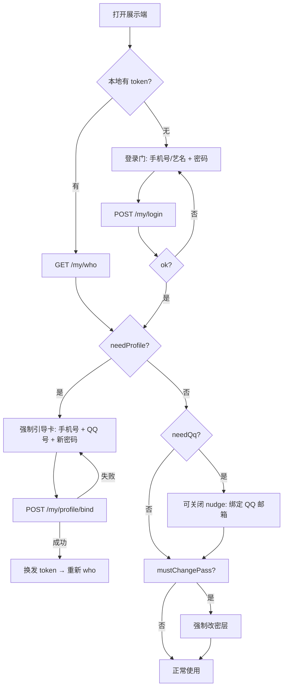
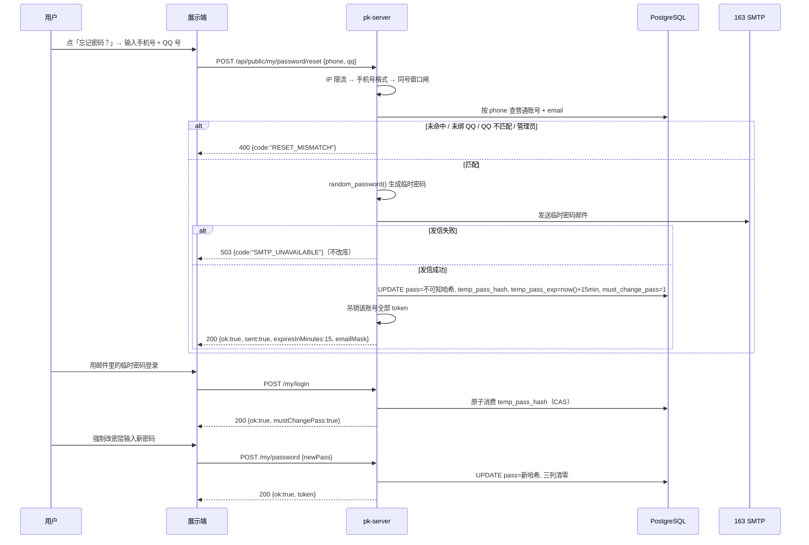

# 26 · 账号绑定 QQ 邮箱、艺名登录与忘记密码设计（主文档）

> **状态**：设计稿 v1 · 2026-10-17 · 待用户拍板后进入实现
> **范围**：展示端账号体系（登录 / 绑定 / 忘记密码）。只做本地开发，不推远端、不做数据库备份（遵循根 `AGENTS.md`）。
> **编写方式**：Lead 汇总 4 份子代理设计，统一裁决跨文档冲突后成文。四份子文档保留为分册（见 §0.1），本文是**唯一执行口径**；子文档与本文冲突处，以本文「§0.2 裁决记录」为准。
> **一句话结论**：展示端账号从「手机号为主」扩为「手机号 / 艺名」双登录标识；绑定邮箱改为「只填 QQ 号、服务端自动补 `@qq.com`」；未绑手机号账号登录后强制补全「QQ + 手机号 + 密码」；已绑手机号未绑 QQ 的账号登录后弹窗提示；忘记密码改为「手机号 + QQ 号双因子 → 临时密码发 QQ 邮箱 → 登录后强制改密」。

---

## 0. 文档索引与裁决记录

### 0.1 子文档索引

| # | 文件 | 负责内容 |
|---|---|---|
| ① | [`26-账号绑定QQ邮箱与艺名登录-设计/01-数据模型与迁移.md`](26-账号绑定QQ邮箱与艺名登录-设计/01-数据模型与迁移.md) | 表结构、QQ 号归一化、迁移 039/040、影响面、迁移执行与回滚 |
| ② | [`26-账号绑定QQ邮箱与艺名登录-设计/02-登录绑定与重置流程.md`](26-账号绑定QQ邮箱与艺名登录-设计/02-登录绑定与重置流程.md) | 状态机、登录解析、强制引导、忘记密码、临时密码、接口契约 |
| ③ | [`26-账号绑定QQ邮箱与艺名登录-设计/03-展示端交互设计.md`](26-账号绑定QQ邮箱与艺名登录-设计/03-展示端交互设计.md) | 登录门、忘记密码弹窗、引导卡、nudge、我的页、`st_page.html` 改动点 |
| ④ | [`26-账号绑定QQ邮箱与艺名登录-设计/04-验收测试与实施计划.md`](26-账号绑定QQ邮箱与艺名登录-设计/04-验收测试与实施计划.md) | 验收矩阵、单测/E2E、本地验证命令、实施拆票、风险与回滚 |

### 0.2 裁决记录（子文档之间的分歧，本文定稿）

| # | 分歧 | 子文档原方案 | **本次裁决** | 理由 |
|---|---|---|---|---|
| R1 | 临时密码有效期 | ① 30 分钟；②③④ 15 分钟 | **15 分钟** | 单次消费 + 强制改密已足够安全；缩短窗口降低邮件被转发/截获风险。用户若嫌短可改 30（常量一处） |
| R2 | 重置后旧密码是否立即失效 | ① 立即失效；②④ 保留旧密码 | **立即失效**（`pass` 覆盖为不可知 CSPRNG 哈希） | 「重设密码」语义；否则知道旧密码的人仍可抢先登录并改密，等于静默接管。管理员后台改密作为兜底 |
| R3 | 临时密码「单次」语义 | 全部为「登录成功即消费」 | **登录成功即原子消费** | 临时密码一旦用于建立会话即作废；用户在改密前丢失登录态需重新申请（成本可接受） |
| R4 | 邮箱唯一性 | ① 单独 040；②④ 建议 partial unique | **040 迁移加 partial unique index**；默认「一个 QQ 只能绑一个账号」 | 并发下应用层查重可被穿透；本地 email 0 行，加索引零风险 |
| R5 | 强制改密拦截层 | ① 中间件；②④ 前端 + 写接口 403 | **服务端中间件拦截**，白名单放行（`who`/登录/改密/`profile/bind`/登出/静态页） | 只靠前端可被 curl 绕过；逐 handler 改 403 又容易漏 |
| R6 | 未绑手机号如何补手机号 | ① 默认找管理员；② 自助提交 | **自助提交**（`profile/bind`，手机号只做格式 + 唯一校验，无短信验证） | 用户口径明确「提示用户绑定 QQ 号码和手机号码然后设置密码」，必须给自助入口；无短信通道是已知残留风险 |
| R7 | 038 存量非 QQ 邮箱 | ① 不清洗、提示重绑；② 允许继续发 | **视为「未绑 QQ」**：不发送、提示重绑，不批量清洗 | 只填 QQ 号是本次口径；把 `xx@163.com` 猜成 QQ 号会发错人 |
| R8 | 管理端 QQ 可见性 | ① 管理端可明文；②③④ 只脱敏 | **默认只脱敏**（`123***@qq.com`），管理员可「代填/代改」，不回显明文 | 后台账号已由 `ADMIN_PASSWORD` 保护，但明文 QQ 会进日志/截图；如运营确需明文，加独立审计接口再说 |
| R9 | 未绑手机号账号在 `who` 的展示名 | ① 改为艺名；现状回手机号 | **回艺名**（`my_accounts.name`），手机号另给脱敏值 | 无手机号时现状 `name` 为空串，水印/我的页会空 |
| R10 | nudge（已绑用户弹窗）频率 | ③ 7 天冷却；④ 每次登录 | **首次登录必弹 + 7 天冷却 + 单会话一次**，可「以后再说」；「我的」页入口常驻 | 兼顾提醒与打扰；用户口径只要求「弹窗提示」，未要求每次都弹 |

---

## 1. 需求原文与口径解读

### 1.1 用户原文

> 本地进行开发，账号支持绑定邮箱，填写qq号码即可，发送到对应的qq邮箱。自动添加后缀。如果没绑定账号的，支持艺名登录，如果没绑定手机号，提示用户绑定QQ号码和手机号码然后设置密码。已经绑定的用户弹窗提示绑定QQ号码。忘记密码就是重设密码需要输入手机号进行和输入qq邮箱，然后发送临时密码到他的邮箱。

### 1.2 逐句解读（设计口径）

| 原句 | 本设计落点 |
|---|---|
| 账号支持绑定邮箱，填写 QQ 号码即可，发送到对应 QQ 邮箱，自动添加后缀 | 绑定入口只收 **QQ 号**（纯数字），服务端 `normalize_qq` + 补 `@qq.com`，存 `my_accounts.email = "<qq>@qq.com"`；前端输入框右侧固定 `@qq.com`，成功后显示脱敏地址 |
| 如果没绑定账号的，支持艺名登录 | 本设计解释为 **S1：账号已存在（`bound=1`）但 `phone=''`，用艺名 + 密码登录**。艺名 = `my_accounts.name` = 台账 `person.name`；现有登录链路已支持姓名路径，本次只补展示与引导。**不是**「无账号凭艺名免密登录」（见 §10-Q1） |
| 如果没绑定手机号，提示用户绑定 QQ 号码和手机号码然后设置密码 | S1 登录后进入**不可关闭的强制引导**：一屏提交 `手机号 + QQ 号 + 新密码`；成功后才放行其他功能 |
| 已经绑定的用户弹窗提示绑定 QQ 号码 | S2（`phone<>''` 且未绑 QQ）登录后弹**可关闭**的绑定提醒；「我的」页常驻「QQ 邮箱」入口；管理员账号不参与 |
| 忘记密码就是重设密码，需要输入手机号进行和输入 QQ 邮箱，然后发送临时密码到他的邮箱 | 未登录页「忘记密码」弹窗收 `手机号 + QQ 号`；二者必须匹配同一普通账号；生成 **临时密码**（15 分钟、单次、登录后强制改密），只发到该账号已绑定的 QQ 邮箱；发信成功才落库 |

### 1.3 关键假设（不确认也先按此设计，但实现前应拍板）

- **A1**：**邮箱唯一、手机号唯一**。同一个 QQ 邮箱不允许绑两个账号；同一手机号已由 `uk_my_phone_uniq` 保证唯一。
- **A2**：**手机号只做格式与唯一校验，不做短信归属验证**（项目无短信通道）。真正的重置凭据是「QQ 邮箱所有权」——临时密码只发到邮箱，知道手机号 + QQ 号但拿不到邮箱的人仍无法登录。
- **A3**：**保留管理员兜底**：任意账号都可由管理员在后台直接设新密码；这是未绑 QQ、邮件丢失、SMTP 故障时的唯一出路。
- **A4**：`bound=0`（未绑主播）账号**不进入**本次引导，继续沿用 `needBind`（提示联系管理员绑定主播）；自助绑定主播接口已于 2026-10-16 删除，不恢复。
- **A5**：管理员观看账号（`is_admin=1`）及管理员快捷口令登录**不参与** QQ 绑定、强制引导与忘记密码重置。

### 1.4 本期做 / 不做

| 做 | 不做 |
|---|---|
| QQ 号绑定/改绑/解绑、自动补后缀、唯一性 | 短信验证码、手机号归属校验、OAuth |
| 艺名 + 密码登录（复用现有姓名路径） | 无账号凭艺名免密登录 / 自助注册（2026-10-14 已下线） |
| 未绑手机号账号强制补全资料 | 恢复展示端自助绑定主播 |
| 已绑用户 QQ 绑定提醒 | 通用邮箱绑定（只收 QQ 邮箱） |
| 手机号 + QQ 双因子忘记密码、临时密码、强制改密 | 邮件送达率优化（SPF/DKIM、换企业邮）纳入后续 |
| 管理端显示 QQ 绑定状态、管理员兜底改密清理临时态 | 生产部署/远端同步 |

---

## 2. 现状与差距

### 2.1 现有账号体系（代码事实）

| 事实 | 位置 |
|---|---|
| `my_accounts` 主键 `name`（登录名 = 艺名）；`phone` 唯一（非空）；`pass` argon2id；`bound` / `person_id` / `view_team` | `rust/crates/pk-server/src/migrations/001_core.sql:210-222`、`:370`、`:374`；`024_my_view_team.sql:24` |
| 038 已加 `email VARCHAR(128) NOT NULL DEFAULT ''`（未提交 WIP） | `rust/crates/pk-server/src/migrations/038_my_account_email.sql:13`；`migrate.rs:196-201` |
| 登录：手机号优先（纯数字 5~20 位），否则按 `name`；失败区分「密码错误 / 账号还没开通」 | `store/my_account.rs:1207-1272`；文案 `:1196-1203` |
| 未绑主播账号登录回 `{ok:true,bound:false,needBind:true}` | `public_teams/my.rs:290-300` |
| 登录限速已按 2026-10-17 口径整体移除，保留地区门禁与 access_logs | `public_teams/my.rs:197-203` |
| 身份接口 `GET /api/public/teams/{team}/my/who` 当前回**明文** `email`；未绑主播分支 `name` 回 `info.phone` | `public_teams/minutes.rs:827-893`（email `:846/892`，name `:855`） |
| 现有忘记密码：只收 `{phone}`，按手机号定位账号 → 随机密码发已绑邮箱 → 改 `pass` | `public_teams/my.rs:563-640`；`store/my_account.rs:1330-1390` |
| 现有绑邮箱：`POST /api/public/my/email {email}` 收完整地址，无唯一性检查 | `public_teams/my.rs:648-689`；`store/my_account.rs:1582-1605` |
| 鉴权 token：内存 + Redis，按账号吊销，TTL 24h | `public_teams/admin.rs:494/519/605`、`:318` |
| 邮件：手写 163 SMTP（`smtp.163.com:465`，隐式 TLS），未配 `SMTP_USER/PASS` fail-closed，单次 20s | `src/mailer.rs`、`src/config.rs:217-253` |
| 随机密码：10 位、去易混淆字符、OS CSPRNG | `src/random.rs:42-47` |
| 管理端账号列表未查 `email`；账号弹窗只有姓名/手机号/密码/团别 | `store/my_account.rs:271-296`；`apps/douyin-web/src/StreamerPage.tsx:348-385`、`:1224-1270` |
| 批量开号：`name = person.name`（艺名）、初始密码 = 手机号后四位，无手机号时随机 10 位（一次性返回） | `store/my_account.rs:978-1010`、`:549-558` |

### 2.2 现状 vs 目标

| 维度 | 现状 | 目标 |
|---|---|---|
| 登录标识 | 手机号 / 姓名（艺名）都要密码 | 不变；补齐「艺名登录」的引导与展示 |
| 绑定邮箱 | 任意完整邮箱；无唯一性；who 回明文 | 只收 QQ 号自动补后缀；唯一；who 回脱敏 |
| 未绑手机号 | 能登录，但「我的」页无有效引导 | 登录后强制补全 QQ + 手机号 + 密码 |
| 已绑手机号未绑 QQ | 无提示 | 登录后 nudge + 我的页常驻入口 |
| 忘记密码 | 只凭手机号，随机密码发邮箱，无时效 | 手机号 + QQ 双因子匹配，临时密码 15 分钟、单次、强制改密 |
| 管理端 | 看不到 QQ 绑定状态 | 列表/弹窗显示 `qqBound`、`emailMask`、`mustChangePass`；兜底改密清临时态 |

### 2.3 本地数据现状（2026-10-17 实测，`douyin_dev`）

- `schema_migrations` 最高 `038_my_account_email`（039 尚未创建/执行）；
- `my_accounts` **68 行**，`email` **全部为空串**（038 从未真实使用）；
- **没有 `phone=''` 的普通账号**（S1 角色需测试时用管理接口造数）；
- 4 个管理员账号、3 个 `bound=0` 艺名账号（注册功能遗留）；
- `person` 台账 103 位在职主播；
- PG 17.11，属主 `zmy`，迁移用 `DB_MIGRATOR_USER=zmy`。

### 2.4 对现有未提交 WIP 的处置

当前 `pg-migration` 分支上已有 `mailer.rs`、038 迁移与「随机密码发邮箱」的忘记密码实现。本次口径**不推翻底层能力**：

- 保留：`mailer.rs`、SMTP 配置、`random_password()`、发信成功才落库的顺序、token 吊销、限流；
- 修改：绑定入口由「任意邮箱」收紧为「QQ 号」；忘记密码由单因子改为手机号 + QQ 双因子；随机密码改为**临时密码**（新增 039 三列 + 强制改密）；`who` 的明文 email 改脱敏；
- 新增：`profile/bind`、QQ 唯一索引（040）、管理端字段。

---

## 3. 状态机与主流程

### 3.1 状态定义

判定维度：`bound`（是否绑主播）、`is_admin`、`phone`（是否绑手机号）、`email`（是否绑合法 QQ 邮箱）、`must_change_pass`。

| 状态 | 判定 | 登录方式 | 登录后动作 |
|---|---|---|---|
| **S1 未绑手机号** | `bound=1 && !is_admin && phone=''` | 艺名 + 密码 | **强制引导** `needProfile=true`：补手机号 + QQ + 密码 |
| **S2 已绑手机号未绑 QQ** | `bound=1 && !is_admin && phone<>'' && !is_qq_email(email)` | 手机号或艺名 + 密码 | 可关闭 nudge `needQq=true`；「我的」页常驻入口 |
| **S3 已绑 QQ（完整）** | `bound=1 && !is_admin && phone<>'' && is_qq_email(email)` | 手机号或艺名 + 密码 | 正常使用；可改绑/解绑 |
| **S4 临时密码待改密** | `must_change_pass=1`（底层必为 S3，重置要求双因子均已绑） | 临时密码（旧密码已失效） | 强制改密 `mustChangePass=true`；改密后回 S3 |
| **B1 未绑主播** | `bound=0 && !is_admin` | 手机号/占位名 + 密码 | `needBind=true`，提示联系管理员（不进入本次引导） |
| **B2 管理员观看账号** | `is_admin=1` 或快捷口令 | 手机号/账号名 + 密码 | 不参与引导、nudge、重置 |

关键字段判定（服务端唯一实现）：

```
needProfile   = !is_admin && bound==1 && phone==''
needQq        = !is_admin && bound==1 && phone!='' && !is_qq_email(email) && !needProfile
mustChangePass= must_change_pass == 1
emailMask     = mask_qq_email(email)   // 未绑 / 非 QQ 邮箱 → ""
```

### 3.2 状态转移表

| # | 当前 | 事件 | 新状态 | 副作用 |
|---|---|---|---|---|
| T1 | — | 管理员开号（手机号选填） | phone 空 → S1；phone 有、QQ 无 → S2 | 初始密码一次性返回 |
| T2 | S1 | 艺名 + 密码登录 | S1 | 响应 `needProfile=true`，前端进强制引导 |
| T3 | S1 | `POST /my/profile/bind {phone,qq,newPass}` | S3 | 单事务写 `phone/email/pass`；吊销旧 token 并换发；写审计 |
| T4 | S1 | 管理员补手机号/QQ | S2 / S3 | 管理员后台改密后清临时态 |
| T5 | S2 | 手机号/艺名 + 密码登录 | S2 | 响应 `needQq=true`，前端弹可关闭 nudge |
| T6 | S2 | `POST /my/email {qq}` | S3 | 写 `email`；返回脱敏地址；`needQq=false` |
| T7 | S3 | `POST /my/email {qq:""}` 解绑 | S2 | 清 `email` 与未消费临时密码；风险提示 |
| T8 | S3 | 忘记密码 `{phone,qq}` 匹配 | S4 | 临时密码邮件 + 写 039 三列 + 吊销该账号全部 token；`pass` 覆盖为不可知哈希 |
| T9 | S2/S1 | 忘记密码 `{phone,qq}` 不匹配/未绑 QQ | 不变 | 统一 400 `RESET_MISMATCH`；不发信、不改库 |
| T10 | S4 | 临时密码登录（常密码已失效） | S4 | 原子消费临时密码；响应 `mustChangePass=true` |
| T11 | S4 | 临时密码过期后登录 | S4 | `{ok:false,code:"TEMP_EXPIRED"}`，需重新申请 |
| T12 | S4 | `POST /my/password {newPass}` | S3 | 改 `pass`；清 039 三列；吊销旧 token、换发新 token |
| T13 | S4 | 管理员后台改密 | S3 | 清 039 三列，避免永久强制改密态 |
| T14 | S3 | 管理员改绑/删除账号 | — | 清临时态；吊销 token |

### 3.3 主流程一：登录 → 强制引导 → 正常使用



### 3.4 主流程二：忘记密码 → 临时密码 → 强制改密



### 3.5 边界

- **B1 `bound=0`**：`name` 可能是旧注册遗留的手机号占位（本地 3 例），没有艺名可登；继续 `needBind`，由管理员绑定主播后 `name` 改为艺名。
- **管理员**：不弹引导、不弹 nudge、不参与重置（`is_admin=0` 过滤）；快捷口令登录身份名固定 `admin-gate`。
- **完全没开号的主播**：`my_accounts` 无行 → 无法登录，只能由管理员批量开号（初始密码一次性下发）。「没绑定账号的，支持艺名登录」不解释为无账号自助认领（见 §10-Q1）。

---

## 4. 数据模型与迁移

### 4.1 存储决策：复用 `email`，不新增 `qq` 列

**决定**：`my_accounts.email` 是唯一事实源，值形如 `"<qq>@qq.com"`；空串 = 未绑定。不新增 `qq` 列、不做生成列。

理由：单事实源、避免双写；038 已存在；展示端只需反解 QQ 号做脱敏；解绑就是置空。

QQ 号规则（服务端为准，前端只做提示）：

- 去首尾空白、去内部空白；其余字符一律拒绝；
- ASCII 数字 `[0-9]`，长度 **5~12**，**首位不能是 0**；
- 兼容粘贴完整 `123456@qq.com`（域名大小写不敏感，剥后缀后再校验）；
- 统一函数（放 `store/my_account.rs` 紧邻 `validate_email`）：

```rust
pub const QQ_MAIL_DOMAIN: &str = "@qq.com";
pub fn normalize_qq(raw: &str) -> Result<String, String>;   // BIZ:: 前缀错误
pub fn qq_to_email(qq: &str) -> Result<String, String>;     // "<qq>@qq.com"
pub fn qq_from_email(email: &str) -> Option<String>;        // 非 QQ 邮箱 → None
pub fn is_qq_email(email: &str) -> bool;
```

`validate_email` 保留（管理端/历史值兜底、防 SMTP 头注入），但展示端绑定入口改走 `normalize_qq`。

### 4.2 迁移 039：临时密码三列（PG、幂等）

文件：`rust/crates/pk-server/src/migrations/039_my_temp_pass.sql`，登记进 `migrate.rs` 的 `MIGRATIONS`（038 之后）。

```sql
-- 039 · 忘记密码「临时密码」模型（2026-10-17 用户口径）
-- 只加列，不动既有列/数据；runner 无事务，全部 IF NOT EXISTS 保证可重放。
-- 不新增 qq 列：QQ 号复用 038 的 email，存 <qq>@qq.com。
-- 不允许用 COMMENT ON（migrate.rs 的 embedded_migrations_split_cleanly 只认
-- CREATE/ALTER/INSERT/UPDATE/DROP TRIGGER/SELECT 开头），语义写在本注释里。

ALTER TABLE my_accounts ADD COLUMN IF NOT EXISTS temp_pass_hash VARCHAR(255) NOT NULL DEFAULT '';
-- '' = 无待使用临时密码；非空 = argon2id PHC 字符串（绝不存明文）。

ALTER TABLE my_accounts ADD COLUMN IF NOT EXISTS temp_pass_exp TIMESTAMPTZ;
-- NULL = 无临时密码；非空 = 绝对失效时刻，判定统一用 PostgreSQL now()。

ALTER TABLE my_accounts ADD COLUMN IF NOT EXISTS must_change_pass SMALLINT NOT NULL DEFAULT 0;
-- 1 = 必须改密（临时密码已签发/已消费）；0 = 正常。沿用 is_admin/bound 的 SMALLINT 口径。
```

生命周期 SQL（业务侧 `?` 占位，经 `crate::pq::rewrite` 转 PG）：

```sql
-- 签发（邮件发送成功后才执行）
UPDATE my_accounts
   SET pass = ?, temp_pass_hash = ?, temp_pass_exp = now() + interval '15 minutes', must_change_pass = 1
 WHERE name = ? AND is_admin = 0;

-- 登录消费（CAS：并发下只有第一个命中）
UPDATE my_accounts
   SET temp_pass_hash = '', temp_pass_exp = NULL, must_change_pass = 1
 WHERE name = ? AND temp_pass_hash = ? AND temp_pass_exp IS NOT NULL AND temp_pass_exp > now();

-- 过期惰性清理
UPDATE my_accounts
   SET temp_pass_hash = '', temp_pass_exp = NULL
 WHERE name = ? AND temp_pass_hash <> '' AND temp_pass_exp IS NOT NULL AND temp_pass_exp <= now();

-- 改密成功 / 管理员改密（统一收口，清三列）
UPDATE my_accounts
   SET pass = ?, temp_pass_hash = '', temp_pass_exp = NULL, must_change_pass = 0
 WHERE name = ?;

-- 解绑 QQ：清 email 与未消费临时密码
UPDATE my_accounts
   SET email = '', temp_pass_hash = '', temp_pass_exp = NULL
 WHERE name = ?;
```

### 4.3 迁移 040：QQ 邮箱唯一索引（默认执行）

```sql
-- 040 · 绑定邮箱唯一（2026-10-17）：一个 QQ 邮箱只能绑一个账号。
-- 建索引前先查重，结果必须 0 行（本地 2026-10-17 实测 email 全空，0 风险）。
-- SELECT email, count(*) FROM my_accounts WHERE email <> '' GROUP BY email HAVING count(*) > 1;
CREATE UNIQUE INDEX IF NOT EXISTS uk_my_email_uniq ON my_accounts (email) WHERE email <> '';
```

> 若产品决定「同一 QQ 允许绑多个账号」（见 §10-Q4），则**不执行 040**，仅保留应用层查重 + 明确文案。默认按「不允许」执行。

### 4.4 影响面（需要改的点）

| 层 | 改动 |
|---|---|
| `store/my_account.rs` | 新增 `normalize_qq`/`qq_to_email`/`qq_from_email`；`my_account_auth_state`（needProfile/needQq/mustChangePass/emailMask）；`my_account_set_qq`（查重 + 23505 兜底）；`my_account_profile_bind`（单事务）；`my_account_temp_pass_issue`；`my_account_temp_pass_consume`；`my_account_reset_target(st, phone, qq)` 双因子；`my_account_check_login` 增加临时密码分支；`my_account_info` 增 email 已有、补 `qq_bound`；`my_account_list` 增 `emailMask`/`qqBound`/`mustChangePass`；所有改密/管理员改密路径清三列 |
| `public_teams/my.rs` | `my_login`/`verify` 响应字段；`my_password_reset` 入参 + 双因子 + 临时密码；`my_email_set` 入参 `{qq}`；新增 `my_profile_bind`；改密接口成功后清三列 + 换发 token |
| `public_teams/minutes.rs` | `who` 增 `needProfile`/`needQq`/`mustChangePass`/`emailMask`；`email` 明文改脱敏；未绑主播分支 `name` 改艺名 |
| `public_teams/wx.rs` | `mask_qq_email`（展示端统一脱敏） |
| `public_teams/admin.rs` | 管理端账号列表/弹窗字段；管理员改密清临时态；可选 `qq` 代绑入参 |
| `main.rs` | 新增 `/api/public/my/profile/bind` 路由；强制改密中间件挂载与白名单 |
| `st_page.html` | 登录门文案、忘记密码弹窗、强制引导卡、nudge、我的页 QQ 行、强制改密层（详见 §6） |
| `apps/douyin-web/src/StreamerPage.tsx` | 管理端账号弹窗显示 QQ 绑定状态（脱敏） |
| 文档 | `docs/07`、`docs/08`、`docs/10`、`docs/13`、`docs/19`、`docs/25` 的旧邮箱/重置口径更新（实现完成后同步） |

### 4.5 迁移执行与回滚（本地）

```bash
# 执行（在 rust/ 下，读 rust/.env；本机表属主 zmy）
cd rust && DB_MIGRATOR_USER=zmy cargo run -p pk-server -- migrate

# 核对
# - schema_migrations 出现 039 / 040
# - SELECT column_name FROM information_schema.columns WHERE table_name='my_accounts' AND column_name LIKE 'temp_pass%';
# - SELECT count(*) FROM my_accounts WHERE email <> '';   -- 迁移前后不变
```

回滚顺序：**先回代码、再回 DB**。

```sql
ALTER TABLE my_accounts
  DROP COLUMN IF EXISTS temp_pass_hash,
  DROP COLUMN IF EXISTS temp_pass_exp,
  DROP COLUMN IF EXISTS must_change_pass;

DROP INDEX IF EXISTS uk_my_email_uniq;

DELETE FROM schema_migrations WHERE version IN ('039_my_temp_pass', '040_my_email_uniq');
```

⚠️ 回滚前必须确认没有账号停留在「`pass` 已被覆盖为不可知哈希 + must_change_pass=1」状态；否则需先由管理员重置密码。038 的 `email` 列不跟着回滚（已被绑定入口使用）。

### 4.6 存量非 QQ 邮箱兼容

- 判定：`email <> '' && !is_qq_email(email)` → 视为 **未绑 QQ**（`needQq=true`），「我的」页显示「已绑定非 QQ 邮箱（不支持自助重置），请重绑 QQ」；
- 忘记密码：不发送、统一 `RESET_MISMATCH`；
- 不清洗、不猜 QQ、不批量改库；本地 0 条，部署前再跑一次核对 SQL。

---

## 5. 接口契约

### 5.1 接口总表

| 方法 | 路径 | 鉴权 | 说明 |
|---|---|---|---|
| POST | `/api/public/my/login` | 无 | 登录（手机号/艺名 + 密码；临时密码也走这里） |
| POST | `/api/public/teams/{team}/verify` | 无 | 带团别登录，响应字段与 `/my/login` 一致 |
| GET | `/api/public/teams/{team}/my/who` | `X-My-Token` | 身份 + `needProfile`/`needQq`/`mustChangePass`/`emailMask`/`phone` |
| POST | `/api/public/my/profile/bind` | `X-My-Token` | **新增**：S1 补手机号 + QQ + 密码（单事务） |
| POST | `/api/public/my/email` | `X-My-Token` | 绑定/改绑/解绑 QQ：`{qq}`，`{qq:""}` = 解绑 |
| POST | `/api/public/my/password` | `X-My-Token` | 已登录改密（含 S4 强制改密）；成功后清三列 |
| POST | `/api/public/my/password/reset` | 无 | 忘记密码：`{phone, qq}` → 临时密码发 QQ 邮箱 |
| GET/POST | `/api/admin/my-accounts*` | 管理员口令 | 列表/弹窗增 `qqBound`/`emailMask`/`mustChangePass`；管理员改密清临时态 |

### 5.2 登录响应（`/my/login`、`/verify`）

```json
{
  "ok": true,
  "token": "<my-token>",
  "personId": 1027,
  "name": "狼佑",
  "team": "male",
  "bound": true,
  "needBind": false,
  "needProfile": false,
  "needQq": true,
  "mustChangePass": false,
  "phone": "199****1234",
  "emailMask": ""
}
```

失败保持 HTTP 200 + `{ok:false}`（现有前端契约）：

```json
{ "ok": false, "code": "BAD_PASSWORD", "error": "密码错误" }
{ "ok": false, "code": "NO_ACCOUNT",  "error": "账号还没开通" }
{ "ok": false, "code": "TEMP_EXPIRED", "error": "临时密码已过期，请重新获取" }
```

### 5.3 `POST /api/public/my/profile/bind`（新增）

请求（仅 `X-My-Token`，身份只认 token）：

```json
{ "phone": "13800138000", "qq": "12345678", "newPass": "abc12345" }
```

校验：手机号 5~20 位纯数字且未被其他账号占用；QQ 号合法且未被占用；密码 4~20 位字母/数字/点；**仅 `phone=''` 的 S1 账号可调用**（`WHERE name=? AND phone=''`）。

成功 200：

```json
{ "ok": true, "token": "<新 token>", "personId": 1027, "name": "狼佑", "team": "male",
  "bound": true, "needProfile": false, "needQq": false, "emailMask": "123***@qq.com" }
```

失败：401 `UNAUTHORIZED`；400 `PROFILE_ALREADY_DONE` / `INVALID_PHONE` / `PHONE_TAKEN` / `INVALID_QQ` / `QQ_TAKEN` / `INVALID_PASS`；429 `RATE_LIMITED`。任一失败**不部分写入**（单事务）。

### 5.4 `POST /api/public/my/email`

```json
// 绑定 / 改绑
{ "qq": "12345678" }
// 解绑
{ "qq": "" }
```

成功：`{ "ok": true, "email": "123***@qq.com", "emailMask": "123***@qq.com" }`；400 `INVALID_QQ` / `QQ_TAKEN`；403 `NEED_PROFILE`（S1 应先引导）；401 过期。兼容旧 `{email}` 入参但只接受 `@qq.com` 域。

### 5.5 `POST /api/public/my/password/reset`（忘记密码）

```json
{ "phone": "13800138000", "qq": "12345678" }
```

成功 200：

```json
{ "ok": true, "sent": true, "channel": "qq-mail", "expiresInMinutes": 15, "emailMask": "123***@qq.com" }
```

错误：

| HTTP | code | 文案 |
|---|---|---|
| 400 | `INVALID_PHONE` | 手机号格式不对：应为 5~20 位数字 |
| 400 | `RESET_MISMATCH` | 手机号与 QQ 号不匹配，或该账号未绑定 QQ 邮箱 |
| 429 | `RATE_LIMITED` | 尝试太频繁，请稍后再试 |
| 503 | `SMTP_UNAVAILABLE` | 邮件服务暂时不可用，请稍后重试或联系管理员 |

- 账号不存在 / 未绑 QQ / QQ 不匹配 / 管理员账号 **共用同一 400 文案**，防手机号存在性枚举；
- 被同号二级闸抑制时返回**与成功同形**的 200（`emailMask:""`），不发信、不改库；
- 顺序：限流 → 手机号格式 → 同号闸 → 定位账号 → QQ 匹配 → 生成临时密码 → 发信 → 落库（覆盖 `pass` + 三列）→ 吊销 token → 记窗口 → 响应。发信失败绝不动库。

### 5.6 `POST /api/public/my/password`（已登录改密 / 强制改密）

`{ "newPass": "..." }` → 200 `{ "ok": true, "token": "<新 token>", "mustChangePass": false }`；成功后清 `temp_pass_hash/temp_pass_exp/must_change_pass`，吊销旧 token 并换发。S4 状态下中间件只放行白名单接口，其他接口 403 `MUST_CHANGE_PASS`。

### 5.7 `who`

在现有字段基础上新增/调整：

- `needProfile`、`needQq`、`mustChangePass`（bool）；
- `emailMask`（脱敏字符串，未绑/非 QQ 为空串）；**不再下发明文 `email`**；
- `phone` 继续服务端打码；未绑主播分支 `name` 改为艺名（无艺名时为空串），不再回手机号占位。

### 5.8 错误码总表

| code | HTTP | 使用场景 |
|---|---|---|
| `INVALID_QQ` | 400 | QQ 号格式非法（绑定 / 引导 / 重置） |
| `QQ_TAKEN` | 400 | 该 QQ 邮箱已被其他账号绑定 |
| `INVALID_PHONE` | 400 | 手机号格式非法 |
| `PHONE_TAKEN` | 400 | 手机号已被其他账号绑定 |
| `INVALID_PASS` | 400 | 密码不符合 4~20 位字母/数字/点 |
| `RESET_MISMATCH` | 400 | 重置双因子不匹配/未绑 QQ/账号不存在/管理员 |
| `SMTP_UNAVAILABLE` | 503 | 邮件服务不可用（未配置/授权失败/超时） |
| `RATE_LIMITED` | 429 | 限流 |
| `PROFILE_ALREADY_DONE` | 400 | 已补全过资料，再调 `profile/bind` |
| `NEED_PROFILE` | 403 | S1 未完成引导却调用受限接口 |
| `MUST_CHANGE_PASS` | 403 | S4 未改密却调用受限接口 |
| `TEMP_EXPIRED` | 200（`ok:false`） | 登录门临时密码过期 |

### 5.9 邮件模板（纯文本，`mailer.rs` 自动 RFC2047 主题 + base64 正文）

- 主题：`抖音PK · 密码重置临时密码（15 分钟内有效）`
- 正文：

```
您好：

您在「抖音PK」展示端申请了密码重置，本次登录临时密码为：

    Ab3kP9xQ2m

该密码 15 分钟内有效，且只能使用一次；登录后系统会要求您立即设置新密码。

如果这不是您本人的操作，请忽略本邮件，您的账号密码不会被修改；
如连续收到本邮件，请联系管理员。

（本邮件由系统自动发送，请勿回复。）
```

不含账号名、手机号、完整 QQ；只发给该账号已绑定的 `<qq>@qq.com`；`mailer` 侧保留 CR/LF 头注入兜底。

---

## 6. 展示端交互（`st_page.html` 单文件）

### 6.1 登录门

- 账号框 placeholder：「手机号 / 艺名」；tip：「用「手机号 / 艺名 + 密码」登录。没绑手机号的账号，登录后会引导你绑定 QQ 邮箱和手机号。」
- 登录失败文案沿用「密码错误 / 账号还没开通」，新增「临时密码已过期，请重新获取」。
- 登录成功按优先级编排：`needProfile` → 强制引导卡；否则 `needQq` → 可关闭 nudge；否则 `mustChangePass` → 强制改密层；否则正常进入。
- 忘记密码入口文案改短「忘记密码？」。

### 6.2 忘记密码弹窗（z-index 96，新建 mask + 复用 `.gate-box`）

```
┌──────────────────────────────┐
│ 重置密码                     │
│ 输入绑定时的手机号和 QQ 号，  │
│ 临时密码会发到你的 QQ 邮箱。  │
│ ┌──────────────────────────┐ │
│ │ 手机号                   │ │
│ └──────────────────────────┘ │
│ ┌──────────────────┬───────┐ │
│ │ QQ 号            │@qq.com│ │
│ └──────────────────┴───────┘ │
│ 将发送到：123456@qq.com       │
│ [错误提示行 .form-err]        │
│ [ 取消 ]      [ 发送临时密码 ]│
└──────────────────────────────┘
```

- 实时校验：手机号 5~20 位数字、QQ 号 5~12 位数字且首位非 0；不合法按钮禁用；
- 提交中按钮「发送中…」；成功态显示「已发送到 123***@qq.com，15 分钟内有效且只能使用一次，登录后请立即修改密码。没收到先看垃圾箱，仍没有请联系管理员。」
- 失败映射：`INVALID_PHONE` → 手机号格式；`RESET_MISMATCH` → 统一指引；`SMTP_UNAVAILABLE` → 邮件服务不可用；`429` → 1 分钟后再试。

### 6.3 强制引导（S1，不可关闭）

- 复用 `#gate` 容器做第三张卡（天然不可关闭、刷新自愈、无 z-index 叠层）；
- 一屏三步字段：`手机号`、`QQ 号（右侧固定 @qq.com）`、`新密码（两遍）`；
- 说明：「第一次用这个账号，先把 QQ 邮箱、手机号和密码补上，之后忘记密码可以自己重置。」
- 按钮「完成绑定，进入数据榜」；成功后换 token、重拉 `who`、关闭登录门；
- 底部小字「换个账号登录」（清 token + reload），不提供跳过；点遮罩/Esc/返回不关闭；
- 手机号可预填台账 `person.phone`（只提示、可改；提交只写 `my_accounts.phone`）。

### 6.4 已绑用户的 QQ 绑定 nudge（S2，可关闭）

- 触发：登录成功且 `needQq=true`；首次必弹；「以后再说」后 7 天冷却；单会话最多一次；
- 文案：「绑定 QQ 邮箱 / 绑定后忘记密码可以自助重置，临时密码会发到你的 QQ 邮箱。」按钮「以后再说 / 立即绑定」；
- 「我的」页「QQ 邮箱」行常驻，未绑时点击直接打开绑定弹窗。

### 6.5 「我的」页

- 行标题「QQ 邮箱」，副标题「忘记密码时，临时密码发到这个邮箱」；右侧显示 `emailMask`（不出现明文）或「未绑定」；
- 修改弹窗：QQ 输入 + 固定后缀，标题「修改 QQ 邮箱 / 当前绑定：123***@qq.com」；
- 解绑：二次确认 + 风险提示「解绑后，忘记密码将无法自助重置，只能联系管理员在后台重置」；
- 绑定/修改成功用服务端返回的 `emailMask` 回填，**不要**用输入原值（修现有 bug）。

### 6.6 强制改密层（S4）

- 复用现有 `openMyPwdDlg`，加 `force` 参数：标题「请设置新密码」，无「取消」、点遮罩/Esc 不关；
- 底部「退出登录」小字（避免改密接口持续失败时锁死）；
- 后端中间件用 403 `MUST_CHANGE_PASS` 兜底；前端 `api()` 捕获后自动弹层。

### 6.7 主要文案（完整表见子文档③附录 A）

| 场景 | 文案 |
|---|---|
| 引导标题 | 绑定账号信息 |
| 引导完成 toast | 绑定完成，开始使用吧 |
| nudge 标题 | 绑定 QQ 邮箱 |
| 绑定成功 toast | QQ 邮箱已绑定 |
| 解绑确认 | 解绑后，忘记密码将无法自助重置，只能联系管理员在后台重置。确定要解绑吗？ |
| 忘记密码统一失败 | 手机号和 QQ 号对不上，或这个账号还没绑定 QQ 邮箱，请核对后重试（忘记绑定 QQ 的联系管理员） |
| 临时密码发送成功 | 临时密码已发送到 QQ 邮箱 |
| 临时密码过期 | 临时密码已过期，请重新获取 |

### 6.8 前端改动点

| 类型 | 位置（`st_page.html`） | 改动 |
|---|---|---|
| 修改 | `showGate()` `2343-2382` | 登录门文案/placeholder；忘记密码链接 |
| 修改 | `bindLoginPane()` `2392-2436` | 成功分支按 `needProfile/needQq/mustChangePass` 编排；传全字段给 `closeGate` |
| 修改 | `forgotPassword()` `2438-2476` | 改为打开忘记密码弹窗（双输入），不再直接请求 |
| 修改 | `loadMy()` `3728-3776` | 正常账号也回填 `emailMask/needQq/mustChangePass`（修「登录后邮箱行仍显示未绑定」） |
| 修改 | 我的页邮箱行 `4016-4021`、点击 `4078` | 改「QQ 邮箱」、显示 `emailMask`、打开 QQ 弹窗 |
| 修改 | `openMyEmailDlg()` `4318-4394` | 整段替换为 `openQqDlg()`：QQ 输入 + 固定后缀、`{qq}` 入参、用响应脱敏值回填、解绑二次确认 |
| 修改 | `openMyPwdDlg()` `4247-4316` | 增加 `force` 模式（不可关闭、退出登录出口） |
| 修改 | `api()` `2216-2237` | 新增 403 `MUST_CHANGE_PASS` / `NEED_PROFILE` 分支 |
| 新增 | 登录门逻辑区 `2477` 附近 | `renderProfileGuide()` / `submitProfile()` |
| 新增 | 「我的」页对话框区 `4318` 附近 | `openQqDlg({source})`、`maybeQqNudge()`、`refreshWho()` |
| 新增 | 样式段 `1487` 后 | `.qq-wrap/.qq-suffix/.qq-preview/.gate-steps/.form-hint/.dialog-close/.link-danger` |
| 修改 | `scripts/fonts/subset-material-symbols.py` | 补 `mail` 图标（当前 ICONS 缺 `mail`，而行内已用）并重跑脚本 |

---

## 7. 安全与风控

### 7.1 威胁模型与缓解

| 威胁 | 缓解 |
|---|---|
| 知道手机号即可触发重置（无短信验证） | 必须同时输入正确 QQ 号；临时密码只发到已绑 QQ 邮箱（邮箱所有权才是真实凭据）；统一失败文案防手机号枚举；限流 |
| QQ 号可被猜/社工 | 5~12 位、首位非 0；重置错误统一文案；登录不限速但临时密码 10 位 CSPRNG；QQ 邮箱可作为第二通知渠道 |
| 临时密码泄露（邮件转发/邮箱撞库） | 15 分钟 TTL、单次消费、登录后强制改密；改密后清三列；重置即吊销全部旧 token |
| 旧密码被离职运营/密码本持有者利用 | 重置成功即覆盖 `pass` 为不可知哈希，旧密码立即失效 |
| 并发重置刷多封邮件 | 同手机号 10 分钟 1 次 / 1 小时 3 次；建议再加「同 QQ 邮箱 1 小时 3 次」；实现改为先原子占坑再发信 |
| SMTP 未配置/授权码失效 | fail-closed；发信失败 503 且**不改库、不吊销 token**；管理员后台兜底 |
| 邮件头注入 | QQ 号纯数字校验 + `validate_email` + `mailer` CR/LF 兜底 |
| 日志/响应泄露邮箱/QQ/密码 | `mask_qq_email`（`123***@qq.com`）；响应不回密码；审计日志手机号/QQ 打码；临时密码不落日志 |
| 强制引导被绕过 | 服务端中间件按 `needProfile`/`mustChangePass` 拦截非白名单接口（403） |
| 绑定/改绑并发重复 QQ | 040 partial unique index + 应用层查重 + SQLSTATE 23505 文案兜底 |

### 7.2 脱敏规则（服务端唯一实现）

- QQ 邮箱：保留 QQ 号前 3 位 + `***@qq.com`（`12345678` → `123***@qq.com`；不足 3 位保留首位）；
- 非 QQ 历史邮箱：沿用现有 `mask_email`（首字符 + `***@域名`）；
- 手机号：沿用 `mask_phone`（`199****1234`）；
- `who` / 登录响应只给 `emailMask`，管理端列表默认也只给 `emailMask`。

### 7.3 限流（沿用 + 建议新增）

| 闸 | 现值/建议 | 说明 |
|---|---|---|
| 重置 IP | 12 次/分 | 现有 `PASSWORD_RESET_LIMITER` |
| 同手机号 | 10 分钟 1 次、1 小时 3 次 | 现有 `RESET_GUARD_*`；被抑制回同形成功包 |
| 同 QQ 邮箱 | **建议 1 小时 3 次** | 防换 IP 骚扰同一收件人；与手机号闸同构 |
| 已登录改密 | 5 次/分 | 现有写口限流 |
| 登录 | **不限速**（2026-10-17 用户口径） | 不恢复；临时密码强度兜底；access_logs 全记 |

### 7.4 残留风险（如实记录）

1. 无短信/实名归属校验：手机号是用户自填，重置的真实安全性依赖 QQ 邮箱所有权；
2. 登录不限速：4 位旧密码理论上可爆破（用户已知悉并接受），新密码规则 4~20 位不变；
3. 163 个人邮箱发 QQ 邮箱可能进垃圾箱/触发反垃圾；需监控送达率，异常时降级为管理员重置；
4. 未绑 QQ 用户忘记密码 = 死局，只能找管理员；「我的」页/登录 nudge 持续提示是主要缓解；
5. 同一 QQ 是否允许绑多个账号属产品决策，默认不允许；若允许，重置链路仍以「手机号 × QQ」锁定单账号。

### 7.5 降级与回滚

| 级别 | 操作 |
|---|---|
| L1 邮件异常 | 隐藏忘记密码入口 / 重置统一 503 文案；管理员后台改密兜底 |
| L2 引导打扰 | 前端关强制引导（保留我的页入口与 nudge）；后端 403 白名单仍生效需同步回退 |
| L3 全量回滚 | 先回代码，再执行 §4.5 的 DB 回滚；`pass` 已被覆盖的账号需管理员重置 |

---

## 8. 验收与实施

### 8.1 角色 × 场景（摘要）

| 角色 | 判定 | 必验场景 |
|---|---|---|
| R1 未绑手机号 | `bound=1, is_admin=0, phone=''` | 艺名登录 → 强制引导 → 补全 → 重登；中途刷新仍回引导；手机号/QQ 被占报错且不部分写入 |
| R2 已绑手机号未绑 QQ | `phone<>'' && !is_qq_email(email)` | 登录 nudge（可关、7 天冷却）；我的页绑定；绑定后 `needQq=false` |
| R3 已绑 QQ | `phone<>'' && is_qq_email(email)` | 改绑/解绑；忘记密码收信 → 临时密码登录 → 强制改密 → 新密码可登录 |
| R4 管理员 | `is_admin=1` 或快捷口令 | 无引导/nudge；不参与重置；后台可兜底改密并清临时态 |
| R5 无账号访客 | 手机号/姓名查不到 | 登录「账号还没开通」；重置统一 `RESET_MISMATCH`；不发信 |

关键 E2E（完整 20 条见子文档④ §2.3）：艺名登录引导、已绑用户 nudge、忘记密码真实收信、临时密码过期/复用、双因子不匹配、SMTP 未配置失败注入、并发重置、旧 038 非 QQ 邮箱、回归。

### 8.2 单测（新增 22 条，分组）

- QQ 归一化/校验（`qq_to_email_normalizes`、`qq_rejects_invalid`、`qq_unique_check`）；
- 状态真值表（`auth_state_truth_table`）；
- 临时密码（随机+哈希、过期边界、CAS 单次、过期登录文案、常密码清理、不落日志）；
- 重置双因子（匹配/管理员拒绝/响应同形/防枚举文案）；
- 清理（自助改密、管理员改密清三列）；
- `profile/bind` 校验与事务；
- 邮件模板与失败注入；
- 迁移登记/顺序（现有测试保持绿）。

### 8.3 本地验证命令

```bash
# 迁移
cd rust && DB_MIGRATOR_USER=zmy cargo run -p pk-server -- migrate

# 单测（示例：现有可复用的一条，本轮实测通过）
cargo test -p pk-server --lib store::my_account::tests::validate_email_accepts_and_rejects

# 全量
cargo test -p pk-server
cargo test --workspace

# 起服务
cargo run -p pk-server        # 读 rust/.env，端口 8787

# SMTP 冒烟（手动，#[ignore]）
cargo test -p pk-server --lib mailer::tests::smtp_live_smoke -- --ignored --nocapture
```

### 8.4 实施拆票

| 票 | 内容 | 依赖 | 写文件范围 |
|---|---|---|---|
| **T1** | 039 迁移 + QQ 归一化 + auth_state + 临时密码 + 双因子 + 清理（store 层） | 本文定稿 | `migrations/039_*.sql`、`migrations/040_*.sql`、`migrate.rs`、`store/my_account.rs` |
| **T2** | 路由/邮件/who/admin 字段 + `/profile/bind` + 中间件门禁 | T1 | `public_teams/my.rs`、`mailer.rs`、`public_teams/minutes.rs`、`public_teams/admin.rs`、`public_teams/wx.rs`、`main.rs` |
| **T3** | 登录门 + 忘记密码弹窗（前端） | T2 契约 | `public_teams/st_page.html`（登录门/忘记密码段） |
| **T4** | 强制引导 + nudge + 我的页 QQ 行 + 强制改密层 | T3 | `st_page.html`（引导/我的页段，**与 T3 同文件串行**） |
| **T5** | 管理端 QQ 状态字段与兜底改密 | T2 | `apps/douyin-web/src/StreamerPage.tsx`、`public_teams/admin.rs`、`store/my_account.rs`（与 T1 协调） |
| **T6** | 验收执行（E2E/回归/迁移幂等/收信） | T1–T5 | 不改源码；验收记录另立文件 |

关键路径：T1 → T2 → T3 → T4 → T6；T5 在 T2 后可与 T3/T4 并行。同一文件（`st_page.html`、`store/my_account.rs`）必须串行或明确分区。

### 8.5 DoD 摘要

- 迁移 039/040 首跑 + 重放幂等，`cargo test -p pk-server` 绿；
- 重置只在发信成功后落库，失败 503 无状态变化；
- `/profile/bind` 单事务，失败不部分写入；
- 登录/who 字段齐全且脱敏，S1/S4 受限接口 403；
- 前端四条链路可点通，375px 无溢出；
- 管理端能看到绑定状态并兜底改密；
- E2E 全量有记录、测试账号清理干净。

---

## 9. 文档同步清单（实现完成后）

| 文档 | 需要更新的内容 |
|---|---|
| `docs/07-后端需求文档.md` | 登录响应字段、`profile/bind`、`/my/email` 入参、重置双因子与临时密码、who 脱敏、错误码 |
| `docs/08-展示端需求文档.md` | 登录门/忘记密码/引导/nudge/我的页 QQ 行 |
| `docs/10-当前功能清单.md` | 账号与邮箱能力描述 |
| `docs/13-主播手机号与批量开号方案.md` | 初始密码与「无手机号账号」引导口径；删除 MariaDB 过时示例 |
| `docs/19-功能与页面文档.md` | 页面交互更新 |
| `docs/25-展示端抖音头像.md` / `docs/22-数据库运维说明.md` | 迁移 039/040、回滚步骤 |
| `AGENTS.md` | 如邮箱/重置口径写入口径区（可选） |

---

## 10. 待用户拍板

> **P0（不定会影响实现方向）**

- **Q1 「没绑定账号的，支持艺名登录」的准确含义**：按本设计 = 账号已存在、未绑手机号（S1），用艺名 + 密码登录后强制补资料。若你指的是「主播根本没有账号，凭艺名直接登录/认领开号」，则要新增「艺名认领」入口（涉及手机号验证、重名处理、安全风险），**请确认是哪种**。
- **Q2 没有 QQ 的主播怎么办**：强制引导要求必须填 QQ 号。可选：① 一律要求（找管理员/客服代绑）；② 允许先只绑手机号 + 设密码，QQ 保留 nudge（需放开 `profile/bind` 的 QQ 必填）；③ 允许其他邮箱（与「QQ 双因子」冲突）。
- **Q3 临时密码参数**：15 分钟、单次、登录后强制改密、重置即作废旧密码——是否照此执行？（子文档曾有 15/30 分钟与「旧密码是否保留」分歧，本稿已裁决为 15 分钟 + 旧密码立即失效。）
- **Q4 同一 QQ 是否只能绑一个账号**：默认「只能一个」（执行 040 唯一索引）。若允许一人多号复用同一 QQ，则不建索引，但需接受「重置时同一 QQ 对应多个账号」的歧义。

> **P1（不定则按默认执行）**

- Q5 绑定 QQ 弹窗频率：默认「首次必弹 + 7 天冷却 + 单会话一次」；
- Q6 忘记密码失败文案：默认统一「手机号与 QQ 号不匹配，或该账号未绑定 QQ 邮箱」（防枚举，牺牲可操作性）；
- Q7 管理端是否显示完整 QQ：默认只脱敏（`123***@qq.com`）；
- Q8 引导时手机号是否预填台账 `person.phone`：默认预填、可改，只写 `my_accounts.phone`；
- Q9 重置限流是否再加「同 QQ 邮箱 1 小时 3 次」：默认加；
- Q10 绑定/重置成功是否发通知邮件：默认只发重置邮件，不发通知；
- Q11 是否恢复登录限速：默认不恢复（沿用 2026-10-17 口径）；
- Q12 未绑 QQ 用户重置死局的兜底：默认「继续提示 + 管理员后台改密」，不新增「艺名 + 管理员」特殊通道。

---

## 附录 A · 关键事实来源

- 表结构与索引：`rust/crates/pk-server/src/migrations/001_core.sql:210-222`、`:370`、`:374`、`024_my_view_team.sql:24`、`038_my_account_email.sql:13`
- 登录与账号：`store/my_account.rs:1207-1272`、`:1509-1615`、`:1330-1390`
- 路由：`public_teams/my.rs:156/487/563/648`；`main.rs:473-484`
- 身份/脱敏：`public_teams/minutes.rs:827-893`；`public_teams/wx.rs:220-253`
- 邮件/SMTP：`src/mailer.rs`、`src/config.rs:217-253`
- 迁移 runner：`migrate.rs:337-418`、`:506-559`
- 本地环境：根 `AGENTS.md`「附：本地环境速查」

## 附录 B · 子文档与本文对应关系

- 数据模型/DDL/回滚 → ①（本文 §4 为定稿版，冲突以本文为准）
- 状态机/接口 JSON/错误码 → ②（本文 §3/§5 为定稿版）
- 页面线框/文案表/`st_page.html` 行号 → ③（本文 §6 为摘要，落地细节以③为准）
- 验收矩阵/用例编号/命令/拆票 → ④（本文 §8 为摘要，执行清单以④为准）
